# 10 RISC-V Cores Technical Analysis: Core Architecture, Memory Sections & Security Mechanisms

This technical reference analyzes the **10 RISC-V processor cores** from the **RISC-V Atlas** website (`SERV`, `PicoRV32`, `Ibex`, `VEGA`, `CV32E40P`, `Rocket Core`, `SweRV EH1 / VeeR EH1`, `VexRiscv`, `SonicBOOM`, and `BOOM`).

Every core is explained in three structured steps:
1. **Step 1 — About the Core (How to Explain It to Someone)**: What the core is, its design goals, and a step-by-step walkthrough of how its datapath and pipeline work.
2. **Step 2 — Every Memory Section Used in the Core**: Detailed breakdown of every register file, fetch buffer, instruction cache / ICCM / ITIM, data cache / DCCM / DTIM / scratchpad, load/store unit (LSU, queues, store buffers, MSHRs), MMU / TLB / Page Table Walker, PMP, bus interface, coherence protocol, and memory ordering model.
3. **Step 3 — Security Mechanisms & Which Attacks They Prevent**: Detailed explanation of how each core defends against unauthorized memory access, timing side channels, cache-timing attacks (`Flush+Reload`, `Prime+Probe`, `Evict+Time`), speculative/transient execution attacks (`Spectre v1/v2/v4`, `Meltdown`), power analysis (`SPA`/`DPA`), and physical fault injection (`glitching` / bit-flips).

## Overview Matrix of the 10 RISC-V Cores

| # | Core | ISA | Pipeline & Execution Model | Memory Sections Used | Key Security & Attack Defenses |
| :--- | :--- | :--- | :--- | :--- | :--- |
| **1** | **[SERV](https://github.com/olofk/serv)** | `RV32I` (+ opt `M`/`Zicsr`) | 1-bit bit-serial state machine (~32–64 cyc/instr) | RAM Register File (2b/cyc), 32b Shift Buf, Wishbone `ibus` & `dbus` (No I$/D$/MMU) | Immune to Spectre/Meltdown & cache timing; fixed 32-cyc serial ALU/shift timing; needs SoC Wishbone firewall |
| **2** | **[PicoRV32](https://github.com/YosysHQ/picorv32)** | `RV32IMC` / `RV32E` | Non-pipelined multicycle FSM (~3–6 CPI) | 32x32b + 4 IRQ `q`-regs in RAM, 16b RVC latch, shared `mem_*` + `mem_la_*` (No I$/D$/MMU) | Immune to Spectre/Meltdown & cache timing; hardware `trap` fail-stop pin; `mem_instr` enables external `W^X` MPU; set `BARREL_SHIFTER=1` for constant-time shifts |
| **3** | **[Ibex](https://github.com/lowRISC/ibex)** | `RV32IMC` + `B` + `Zkt` | 2- or 3-stage in-order (`IF -> ID/EX -> [WB]`) | 39b SECDED ECC RegFile, PRINCE-scrambled ECC 2-way I$, no D$ (deterministic SRAM), 39b ECC OBI/TL-UL bus, 16-region `Smepmp` | OpenTitan Root-of-Trust (`SecureIbex`): `DataIndTiming` (`Zkt`), no D$ + scrambled I$, Dummy Instructions (`SPA`/`DPA`), Delayed Dual-Core Lockstep + ECC + Shadow CSRs (`Glitching`) |
| **4** | **[VEGA](https://vegaprocessors.in/)** | `RV32IM` to `RV64GC` | 3/5/6-stage In-Order (`ET1031`/`AT1051`/`AS1061`) to 16-stage OoO (`AS1161`/`2161`/`4161`) | Uncached SRAM (`ET1031`); 8KB L1I/L1D (`AS1061`); 32KB L1I/L1D + 512KB/1MB ACE-coherent L2 + `Sv39` MMU/TLB (`AS2161`/`4161`) | In-order `ET1031`/`AS1061` avoid OoO transient leaks; `Sv39` MMU isolates OS/user; 16-stage OoO `AS1161–4161` require `FENCE` & predictor/cache mitigations against Spectre & shared-L2 probing |
| **5** | **[CV32E40P](https://github.com/openhwfoundation/cv32e40p)** | `RV32IMCF` + `Xpulp` | 4-stage in-order (`IF -> ID -> EX -> WB`) | 3-read/2-write RegFile, 2-level HW Loop regs, 4-word Prefetch FIFO, dual OBI buses to TCM (No I$/D$/MMU/PMP) | Immune to Spectre/Meltdown & cache timing; deterministic HW loops & 1-cyc MAC; M-mode only (requires OBI firewall or sibling **CV32E40S** for `U-mode`, `Smepmp`, `Zkt`, Lockstep) |
| **6** | **[Rocket Core](https://github.com/chipsalliance/rocket-chip)** | `RV64GC` / `RV32GC` | 5-stage single-issue in-order (`IF -> ID -> EX -> MEM -> WB`) | 31 Int + 32 FP Regs, 16–32KB 4-way VIPT L1I (+ opt `ITIM`), 16–32KB non-blocking `HellaCache` L1D (+ MSHRs / `DTIM`), `Sv39` ITLB/DTLB/PTW, TileLink Inclusive L2 | Branch resolution in `EX` before `MEM` makes L1D immune to Spectre v1 & Meltdown; `M/S/U` + `Sv39` + 8–16 `PMP` regions power **Keystone** & **MIT Sanctum** (L2 page-coloring set partitioning) |
| **7** | **[SweRV EH1 (VeeR EH1)](https://github.com/chipsalliance/Cores-VeeR-EH1)** | `RV32IMC` + `Zba`/`Zbb`/`Zbs` | 9-stage dual-issue in-order superscalar (4 ALUs at `EX1` & `EX3`) | 4R/3W RegFile, 4–512KB SECDED ECC `ICCM`, 4–512KB 8-bank SECDED ECC `DCCM` (No D$), opt 4-way ECC L1 I$, 8-entry Store/Write Buffer, 16-region `MRAC`, AXI4 + DMA | Zero D$ (`DCCM`/`ICCM`) eliminates data-cache timing attacks; `MRAC` side-effect gating blocks speculative MMIO loads; hardware SECDED ECC auto-scrubs single-bit glitches; basis of `VeeR EL2` (Caliptra RoT) |
| **8** | **[VexRiscv](https://github.com/SpinalHDL/VexRiscv)** | `RV32IMAFDC` + `CFU` | 2- to 5-stage in-order SpinalHDL plugin pipeline (`F -> D -> E -> M -> W`) | LUTRAM/BRAM RegFile, `IBusSimple` or VIPT `IBusCachedPlugin`, `DBusSimple` or Write-Through `DBusCachedPlugin`, `Sv32` `MmuPlugin` (+ `ioRange` uncached map), `PmpPlugin` | In-order pipeline prevents Spectre/Meltdown; `CsrPlugin` (`M/S/U`) + `Sv32` `MmuPlugin` + `PmpPlugin` isolate domains; use `FullBarrelShifterPlugin` & `CfuPlugin` for constant-time crypto; gate `DebugPlugin` |
| **9** | **[SonicBOOM (BOOMv3)](https://github.com/riscv-boom/riscv-boom)** | `RV64GC` | 1- to 5-wide Out-of-Order superscalar (`FTQ` + `TAGE-L` + 128-entry `ROB`) | 128 Int + 128 FP Phys Regs (`PRF`), 32-entry `LDQ` & 32-entry `STQ`, 32KB 8-way L1I, 32KB 8-way 8-bank non-blocking L1D (8 MSHRs), `Sv39` ITLB/2-port DTLB/L2 STLB/PTW, TileLink L2 | `DTLB` check in `M1` blocks **Meltdown**; deep OoO speculation (`TAGE-L` + `LDQ`/`STQ`) exposes baseline RTL to **Spectre v1/v2/v4** & cache timing; primary open platform for `FENCE`, `InvisiSpec`, `STT`, `DAWG`, & `Keystone` |
| **10** | **[BOOM (v1/v2)](https://github.com/riscv-boom/riscv-boom)** | `RV64G` / `RV64GC` | 10-stage Out-of-Order superscalar (Explicit Rename + Unified `PRF` + `ROB`) | Unified `PRF` + Free List, 3-queue LSU (`LAQ`, `SAQ`, `SDQ`), reused Rocket L1I, non-blocking `HellaCache` L1D, `Sv39` ITLB/DTLB/PTW, `PMP`, and TileLink L2 | Reusing Rocket's exact `HellaCache` & MMU makes Rocket vs. BOOMv2 the ultimate A/B demonstration of OoO **Spectre v1/v2/v4** exposure while preserving `DTLB` **Meltdown** immunity |

## Core 1: [SERV (SErial RISC-V)](https://serv.readthedocs.io/en/latest/)

* **Official Documentation**: [https://serv.readthedocs.io/en/latest/](https://serv.readthedocs.io/en/latest/)
* **Source Repository**: [https://github.com/olofk/serv](https://github.com/olofk/serv)

### Step 1: About the Core (How to Explain SERV to Someone)

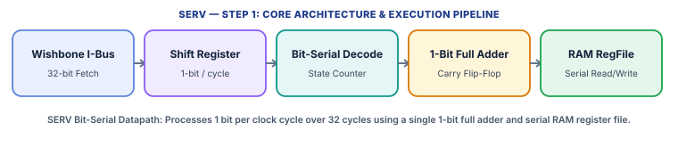

SERV (SErial RISC-V), created by Olof Kindgren, is the world's smallest synthesizable RISC-V processor core. When explaining SERV to someone, start with one core idea: instead of processing all 32 bits of a number in parallel during a single clock cycle like a conventional CPU, SERV shrinks its entire datapath—its Arithmetic Logic Unit (ALU), shift logic, and register file read/write ports—down to a single bit wide (or 4 bits in its QERV sibling). Every 32-bit operation is performed bit-by-bit (Least Significant Bit first) across 32 consecutive clock cycles.

| Architectural Property | Specification & Design Choice |
| :--- | :--- |
| **Base ISA & Extensions** | RV32I base integer ISA; optional Zicsr (4 CSRs for traps/timers) and MDU (external serial Multiply/Divide unit) |
| **Datapath Width** | 1-bit bit-serial internal datapath (32 cycles per 32-bit bit-serial phase) |
| **Execution Model** | Non-pipelined bit-serial state machine (Fetch -> Serial Shift/Execute -> Memory/Writeback) |
| **Privilege Architecture** | Machine Mode (M-mode) only; optional lightweight trap handling (mcause, mepc, mtvec, mstatus) |
| **Hardware Footprint** | ~125–200 FPGA LUTs / ~2.1 kGE ASIC area (allows hundreds of cores on one small FPGA) |
| **Implementation Language** | Verilog (validated with RISC-V Formal and riscv-arch-test) |

#### Step-by-Step Pipeline & Execution Walkthrough

* **1. 32-Bit Instruction Fetch (Wishbone I-Bus)**: SERV requests a 32-bit instruction word over its Wishbone instruction bus (wb_ibus). As the instruction arrives, decode logic latches the opcode, immediate control bits, and register indices (rs1, rs2, rd).
* **2. 5-Bit Counter & Two-Phase Bit-Serial Execution**: A 5-bit internal counter (counting 0 to 31) drives execution. One-stage instructions (ADD, SUB, SLT, AND, OR, XOR) execute in a single 32-cycle serial phase: on each clock cycle, 1 bit of rs1 and 1 bit of rs2 stream out of the serial Register File RAM into a 1-bit full adder, which computes 1 result bit, stores the carry bit in a single flip-flop for the next cycle, and writes the 1-bit result directly into rd.
* **3. Two-Stage Operations (Shifts, Branches, Loads/Stores)**: Shifts, conditional branches, and loads/stores use two 32-cycle phases (~64 cycles total plus bus latency). Phase 1 serializes the shift amount, branch comparison, or effective memory address calculation into an internal shift register; Phase 2 shifts out the aligned result or performs the Wishbone data bus transaction.
* **4. Why This Architecture Matters**: Because 32-bit multiplexers, 32-bit barrel shifters, and 32-port flip-flop register files dominate the silicon area of small CPUs, replacing them with 1-bit serial wires and a narrow Block RAM makes SERV roughly 4x to 10x smaller than even compact multicycle cores.

### Step 2: Every Memory Section Used in SERV

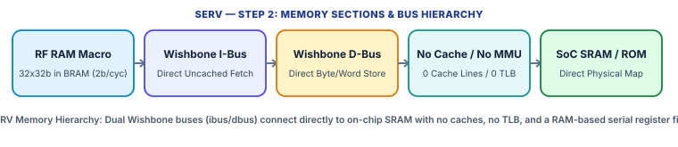

SERV has the most stripped-down memory structure of any RISC-V processor. It contains zero internal caches, zero translation buffers, and no flip-flop register array—instead using embedded RAM for registers and direct Wishbone buses for all memory references.

#### 2.1 Serial Register File in Embedded RAM (RF RAM)

* Architecture & Storage Section: Instead of building 32 architectural registers (x0–x31) out of 1,024 D-flip-flops with wide 32-bit read/write multiplexers, SERV stores all 32 architectural registers (plus 4 optional CSRs when WITH_CSR is enabled) inside a small, narrow on-chip SRAM or FPGA Block RAM macro (typically configured as 2 bits wide x 512 entries).
* Serial Access Mechanism: During the 32-cycle execution window, the 5-bit cycle counter concatenates with the 5-bit register number to address individual bit pairs sequentially. On each cycle, `rs1` and `rs2` are read bit-serially and `rd` is written bit-serially.
* Error Protection: The RF RAM carries no parity or ECC bits; any radiation or glitch bit-flip inside the dual-port RAM directly alters architectural register state.

#### 2.2 Internal Shift / Address Buffer Registers

* 32-Bit Serial-to-Parallel Interface: Because external Wishbone memories and peripherals expect a full 32-bit address (`wb_dbus_adr`) and 32-bit write data (`wb_dbus_dat`) simultaneously, SERV uses a 32-bit internal shift register in its `serv_bufreg` module to accumulate the bit-serially computed effective address (`rs1 + imm`) over 32 cycles before asserting the bus request.
* Load Data Serialization: When a 32-bit word returns from the data bus (`wb_dbus_rdt`), it is captured and shifted into the destination register in the RF RAM 1 bit per cycle over 32 cycles (performing sign-extension on the fly for `LB` and `LH`).

#### 2.3 Instruction Memory Path (Wishbone `wb_ibus`)

* No Instruction Cache (I$) or Prefetch Queue: SERV has no L1 instruction cache, no branch predictor, and no prefetch FIFO.
* Direct Wishbone Handshake: The instruction port exposes `wb_ibus_adr[31:2]`, `wb_ibus_cyc`, and `wb_ibus_ack` to fetch one 32-bit instruction word per instruction execution cycle from external ROM or Tightly Coupled SRAM (such as the shared SRAM in the `Servant` reference SoC).

#### 2.4 Data Memory Path (Wishbone `wb_dbus`)

* No Data Cache (D$), No Store Buffer, No MSHRs: SERV does not cache data or buffer writes. Every `LW`, `LH`, `LB`, `SW`, `SH`, or `SB` stalls the serial state machine until the external Wishbone slave responds with `wb_dbus_ack`.
* Byte-Lane Selection & Alignment: Sub-word reads and writes use the 4-bit Wishbone byte-select strobe (`wb_dbus_sel[3:0]`). When compiled with `WITH_CSR`, unaligned word/halfword addresses trigger a synchronous misaligned load/store trap to `mtvec`.

#### 2.5 Virtual Memory, MMU, TLB, Coherence & Memory Ordering

* No MMU, No TLB, No PMP: All 32-bit addresses emitted by SERV are direct, untranslated physical addresses.
* Coherence & Consistency Model: Because SERV is a single-hart, non-pipelined core that issues at most one memory access at a time and has no caches or store buffers, it naturally enforces strict Sequential Consistency (stronger than RVWMO). The `FENCE` instruction executes as a architectural no-op because no older memory operation can ever be in flight when `FENCE` runs.

### Step 3: Security Mechanisms & How SERV Prevents Attacks

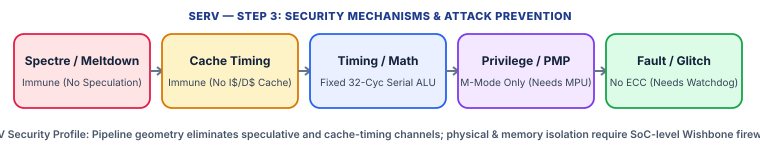

SERV's security properties come entirely from its extreme structural simplicity rather than built-in hardware security extensions. Because it lacks speculation, caches, and out-of-order buffers, entire families of microarchitectural attacks physically cannot exist on SERV—while software isolation and physical fault protection must be engineered in the surrounding SoC wrapper.

| Attack / Threat Vector | Core / SoC Mechanism Used | How It Prevents or Mitigates the Attack |
| :--- | :--- | :--- |
| **Spectre v1 / v2 / v4 (Transient Execution)** | Hardware Architecture (Non-Pipelined, Zero Speculation) | 100% Immune — SERV has no branch predictor, no Reorder Buffer, and never fetches or executes instructions speculatively. |
| **Meltdown / Foreshadow / MDS (Faulting Load Leaks)** | Direct Physical Bus, No Privilege Speculation | 100% Immune — No user/supervisor page tables or speculative load forwarding exist. |
| **Cache-Timing Attacks (Flush+Reload, Prime+Probe, Evict+Time)** | Absence of L1/L2 Instruction & Data Caches | 100% Immune Inside Core — With zero cache lines and zero tag arrays, all accesses go straight to deterministic SRAM. |
| **Software Timing Side Channels (Early-Exit / Operand Timing)** | Deterministic 32-Cycle Bit-Serial ALU (`ADD`, `XOR`, Shifts) | Constant-time for base RV32I ALU/shift ops (always 32 or 64 cycles regardless of shift amount!), though external MDU division and software branches still require constant-time coding. |
| **Unauthorized Memory Access / Privilege Escalation** | None Inside Core (M-Mode Only, No PMP/MMU) | Vulnerable without SoC Wrapper — Requires an external Wishbone address-decoder firewall / MPU to restrict memory regions. |
| **Power Analysis (SPA / DPA) & Fault Injection (Glitching)** | 1-Bit Switching Profile (Low Switching Noise); No ECC/Lockstep | 1-bit datapath lowers instantaneous SNR for SPA, but DPA and clock/voltage glitching require external SoC countermeasures and watchdogs. |

#### 3.1 Prevention of Speculative & Transient Execution Attacks (Spectre & Meltdown)

Transient execution attacks (Spectre v1 bounds-check bypass, Spectre v2 branch-target injection, Spectre v4 speculative store bypass, and Meltdown) require a processor that guesses branch outcomes or continues executing ahead of unresolved faults, leaving a secret-dependent footprint in a data cache. SERV is a strictly sequential bit-serial state machine: when it encounters a conditional branch (`BEQ`, `BNE`, `BLT`), it serially compares `rs1` and `rs2` over 32 cycles and updates the Program Counter (`PC`) before fetching the next instruction. No wrong-path instruction is ever fetched, decoded, or executed, making Spectre and Meltdown physically impossible.

#### 3.2 Prevention of Cache-Timing Attacks (`Flush+Reload`, `Prime+Probe`, `Evict+Time`)

Cache-timing attacks measure the latency gap between a cache hit and a cache miss to deduce which memory addresses a victim touched. Because SERV contains neither an instruction cache nor a data cache, every load and store accesses on-chip SRAM directly over the Wishbone bus with uniform latency. An attacker cannot prime, evict, or flush cache sets inside SERV. (If multiple masters share an external multi-port SRAM arbiter, only bus-contention timing exists, which is mitigated using static TDMA bus arbitration.)

#### 3.3 Protection Against Timing Side Channels (Constant-Time Bit-Serial Advantage)

In many small microcontrollers, multi-bit shifts (`SLL`, `SRL`, `SRA`) use an iterative shifter whose cycle count equals the shift amount (leaking secret shift counts via timing). In SERV, every shift and every arithmetic/logical instruction streams through the 1-bit serial datapath in a fixed number of 32-cycle phases regardless of operand values or shift distance. As long as software avoids secret-dependent conditional branches (`if (secret_bit)`) and avoids variable-latency external division, SERV executes cryptographic bit-sliced routines in constant time.

#### 3.4 Memory Isolation & Privilege Defenses (How to Secure SERV at the SoC Level)

Because SERV implements only Machine Mode (`M-mode`) and omits both an MMU and RISC-V Physical Memory Protection (`PMP`), any code running on SERV has full read/write/execute authority over the entire Wishbone address map. To prevent buggy or compromised firmware from overwriting code or stealing keys in adjacent peripherals, SoC designers place a hardware **Wishbone Bus Firewall / Address Decoder** on `wb_ibus` and `wb_dbus`: (1) `wb_ibus` is wired exclusively to read-only Boot/Code ROM (`W^X` enforcement in hardware wiring), and (2) `wb_dbus` address ranges are masked so SERV can only read/write its dedicated data scratchpad and authorized MMIO registers.

#### 3.5 Physical Side Channels (`SPA`/`DPA`) & Fault Injection (`Glitching`) Analysis

During Simple/Differential Power Analysis (`SPA`/`DPA`), a 32-bit parallel ALU switches up to 32 bus wires simultaneously, producing large Hamming-distance current spikes. SERV switches only 1 bit per clock cycle in its ALU and 2 bits in its RF RAM, drastically reducing instantaneous current spikes—though statistical DPA over 32-cycle windows can still correlate bit transitions unless software uses Boolean masking. Against **Fault Injection (Voltage/Clock Glitching)**, SERV lacks internal register ECC or lockstep logic; however, because its entire core is only ~150 LUTs, designers can instantiate **two SERV cores in Dual-Core Lockstep** (comparing `wb_ibus_adr`, `wb_dbus_adr`, and `wb_dbus_dat` every cycle) for less area than a single conventional 32-bit pipeline!

## Core 2: [PicoRV32](https://github.com/YosysHQ/picorv32)

* **Official Documentation**: [https://github.com/YosysHQ/picorv32](https://github.com/YosysHQ/picorv32)
* **Source Repository**: [https://github.com/YosysHQ/picorv32](https://github.com/YosysHQ/picorv32)

### Step 1: About the Core (How to Explain PicoRV32 to Someone)

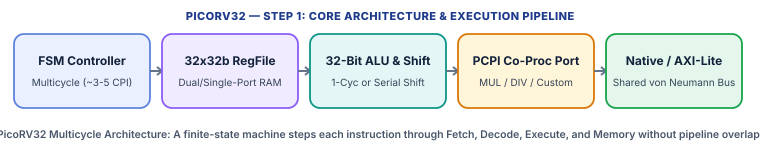

PicoRV32, designed by Claire Wolf (YosysHQ), is a compact, high-frequency 32-bit RISC-V (`RV32IMC`) soft processor written in a single standalone Verilog file (`picorv32.v`). To explain PicoRV32 to someone, contrast it with both a 5-stage pipeline (like Rocket) and a 1-bit serial core (like SERV): PicoRV32 has a full **32-bit wide parallel ALU and register file**, but it is **multicycle (non-pipelined)**. Instead of overlapping five instructions at once, a finite-state machine (FSM) executes **one instruction at a time** from start to finish in 3 to 6 short clock cycles. Eliminating pipeline registers, hazard detectors, and bypass forwarding networks shrinks the core to ~750–2,000 LUTs while letting it reach very high clock speeds (250–450 MHz on modern FPGAs).

| Architectural Property | Specification & Design Choice |
| :--- | :--- |
| **Base ISA & Extensions** | RV32I or RV32E (16 regs); optional M (Multiply/Divide via PCPI), C (16-bit Compressed), and non-standard custom IRQ instructions |
| **Microarchitecture Style** | Non-pipelined Multicycle Finite-State Machine (FSM); ~3 to 6 cycles per instruction (CPI) |
| **Datapath Width** | 32-bit parallel ALU, register file, and memory data path |
| **Co-Processor Interface** | PCPI (Pico Co-Processor Interface) for offloading `MUL`/`DIV` or custom crypto accelerators |
| **Memory Bus Options** | Native valid/ready bus (`mem_*`), Look-Ahead bus (`mem_la_*`), AXI4-Lite master wrapper, Wishbone master wrapper |
| **Privilege & Fault Model** | Flat machine-level execution; hardware `trap` output pin + optional custom 32-channel IRQ controller |

#### Step-by-Step Pipeline & Execution Walkthrough

* **1. FSM State 1 — Instruction Fetch (`cpu_state_fetch`)**: The FSM places the Program Counter (`reg_pc`) onto the shared memory bus with `mem_instr = 1` and waits for `mem_ready`. A 16-bit/32-bit instruction aligner/prefatcher handles compressed (`RV32C`) instructions spanning 32-bit word boundaries.
* **2. FSM State 2 — Decode & Register Latch (`cpu_state_ld_rs1` / `ld_rs2`)**: The instruction is decoded and source registers `rs1` and `rs2` are read from the Register File RAM (either simultaneously in 1 cycle when `ENABLE_REGS_DUALPORT = 1`, or sequentially over 2 cycles when `ENABLE_REGS_DUALPORT = 0`).
* **3. FSM State 3 — Execute (`cpu_state_exec` / `cpu_state_shift`)**: The 32-bit ALU computes arithmetic, logic, and branch comparisons in 1 cycle. Shifts take either 1 cycle (`BARREL_SHIFTER = 1`), 1–5 cycles (`TWO_STAGE_SHIFT = 1`), or 1–32 cycles (serial shift). If an instruction is an `M`-extension multiply/divide or custom opcode, PicoRV32 asserts `pcpi_valid` on the **PCPI (Pico Co-Processor Interface)** and waits for the co-processor (`picorv32_pcpi_mul` / `fast_mul` / `div`) to return `pcpi_ready` and `pcpi_rd`.
* **4. FSM State 4 — Memory Access (`cpu_state_stmem` / `cpu_state_ldmem`) & Writeback**: For `LW`/`SW`, the FSM drives the calculated address onto the shared memory bus with `mem_instr = 0`, writes or latches the data word, writes the result back to `rd`, and loops back to Fetch.

### Step 2: Every Memory Section Used in PicoRV32

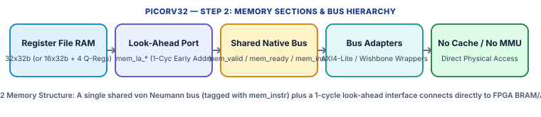

PicoRV32 uses a unified (von Neumann) uncached memory architecture designed to connect directly to FPGA Block RAM (BRAM) or an AXI4-Lite / Wishbone fabric with minimal wiring overhead.

#### 2.1 Register File Memory (`cpuregs` Array)

* Configurable Register Capacity: By default, PicoRV32 allocates 32 general-purpose 32-bit registers (`x0`–`x31`). Setting `ENABLE_REGS_16_31 = 0` shrinks this to 16 registers (`RV32E`). When `ENABLE_IRQ = 1`, 4 additional special interrupt shadow registers (`q0`–`q3`) are added in the same RAM block (36 entries total) to save context during interrupts without touching the software stack.
* Dual-Port vs. Single-Port Mapping: Controlled by `ENABLE_REGS_DUALPORT` (default `1`). Dual-port mode maps to two FPGA LUTRAM/BRAM read ports so `rs1` and `rs2` are fetched in the same clock cycle; single-port mode halves RAM port usage at the cost of 1 extra cycle for two-operand instructions.
* Error Protection: The `cpuregs` array is a raw unencoded Verilog memory array with no parity or ECC bits.

#### 2.2 Unified Native Memory Interface (`mem_*`) & 16-Bit RVC Prefetch Buffer

* Shared von Neumann Port: Unlike Harvard cores with separate instruction and data ports, PicoRV32 uses a single shared memory bus (`mem_valid`, `mem_ready`, `mem_addr[31:0]`, `mem_wdata[31:0]`, `mem_wstrb[3:0]`, `mem_rdata[31:0]`). Because the core is non-pipelined, instruction fetch and data load/store never happen on the same cycle! The core outputs a 1-bit `mem_instr` flag (`1` during instruction fetch, `0` during data load/store) so external bus logic or firewalls can still distinguish code fetches from data accesses.
* 16-Bit Compressed Instruction Buffer: When `COMPRESSED_ISA = 1`, a small internal 16-bit latch holds the upper half of a 32-bit memory word whenever a 16-bit compressed instruction is fetched, avoiding redundant bus reads.

#### 2.3 Look-Ahead Memory Interface (`mem_la_*`)

* Zero-Wait-State FPGA BRAM Optimization: Standard synchronous FPGA Block RAMs require the address to be registered at the clock edge before data appears on the next cycle. PicoRV32 provides a combinatorial **Look-Ahead Memory Interface** (`mem_la_read`, `mem_la_write`, `mem_la_addr`, `mem_la_wdata`, `mem_la_wstrb`) that outputs the next memory transaction's address and control signals **one clock cycle early** (before the `mem_valid` register stage). Connecting FPGA BRAM directly to `mem_la_*` saves 1 full clock cycle on every instruction fetch and load!

#### 2.4 Bus Protocol Adapters (`AXI4-Lite` & `Wishbone`) and Absence of Caches/MMU

* No L1 I-Cache, No L1 D-Cache, No Store Buffer, No MMU/TLB: PicoRV32 contains no internal caches and performs no virtual-to-physical address translation. Every address is a direct 32-bit physical address.
* Synthesizable Wrappers: `picorv32.v` includes `picorv32_axi` (a core with a native AXI4-Lite master interface), `picorv32_axi_adapter` (bridging `mem_*` to AXI4-Lite `AW/W/B/AR/R` channels), and `picorv32_wb` (bridging `mem_*` to a Wishbone master port).
* Alignment & Memory Ordering: Setting `CATCH_MISALIGN = 1` checks that word accesses have `addr[1:0] == 2'b00` and halfword accesses have `addr[0] == 1'b0`, asserting a trap/IRQ on violation. Because instructions execute strictly one at a time with no store buffer or cache, memory ordering is strictly sequential.

### Step 3: Security Mechanisms & How PicoRV32 Prevents Attacks

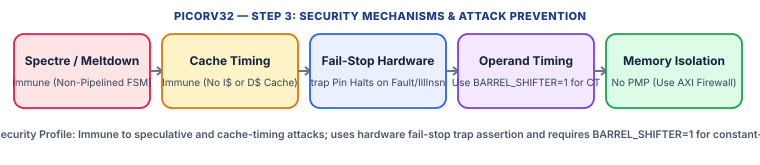

PicoRV32 is designed as a lightweight embedded controller rather than a multi-user operating-system CPU. It is naturally immune to all speculative and cache-timing side channels, provides a unique hardware fail-stop `trap` pin for fault containment, and requires specific synthesis parameters (`BARREL_SHIFTER`) and SoC bus wrappers to harden against timing and memory-isolation attacks.

| Attack / Threat Vector | Core / SoC Mechanism Used | How It Prevents or Mitigates the Attack |
| :--- | :--- | :--- |
| **Spectre v1 / v2 / v4 & Meltdown (Transient Execution)** | Non-Pipelined Multicycle FSM (Zero Speculation) | 100% Immune — Only one instruction exists in the core at any instant; branches resolve completely before the next fetch. |
| **Cache-Timing Attacks (Flush+Reload, Prime+Probe, Evict+Time)** | Zero Internal Instruction or Data Caches | 100% Immune Inside Core — All memory accesses traverse the direct `mem_*` bus with deterministic BRAM/bus latency. |
| **Software & Operand Timing Side Channels** | Configurable Shifter (`BARREL_SHIFTER`) & PCPI Multiplier (`ENABLE_FAST_MUL`) | Default serial shifter/divider leaks operand values via cycle counts; setting `BARREL_SHIFTER=1` and `ENABLE_FAST_MUL=1` eliminates variable shift/multiply timing. |
| **Code Injection (`W^X`) & Unauthorized Memory Access** | 1-Bit `mem_instr` Signal on Native Memory Bus | Although PicoRV32 lacks internal PMP/MMU, an external 10-line Verilog bus wrapper can inspect `mem_instr` and `mem_wstrb` to enforce strict `W^X` (Execute-Only Code ROM, Non-Executable Data RAM)! |
| **Control-Flow Corruption & Illegal Opcode Glitches** | `CATCH_ILLINSN=1`, `CATCH_MISALIGN=1`, and Hardware `trap` Pin | Detects illegal instructions and unaligned pointers in hardware, immediately halting the FSM and asserting the external `trap` pin (fail-stop behavior). |
| **Physical Glitching & Power Analysis (`SPA` / `DPA`)** | PCPI Custom Co-Processor Offload + External Watchdog on `trap` | Sensitive crypto can be offloaded to a masked/constant-time PCPI hardware accelerator while an SoC watchdog monitors `trap` and `mem_valid`. |

#### 3.1 Complete Immunity to Speculative Execution (`Spectre` / `Meltdown`) and Cache-Timing Attacks

Because PicoRV32 is a non-pipelined multicycle state machine with no branch predictor, no instruction prefetch queue beyond 16-bit halfword alignment, no out-of-order execution, and no data or instruction caches, it never touches memory speculatively and holds no secret-dependent cache tags. Consequently, `Spectre` (v1, v2, v4), `Meltdown`, `Flush+Reload`, `Prime+Probe`, and `Evict+Time` cannot operate against PicoRV32.

#### 3.2 Eliminating Variable-Latency Timing Side Channels via Synthesis Parameters

In PicoRV32's default area-optimized configuration (`BARREL_SHIFTER = 0`, `TWO_STAGE_SHIFT = 1`), a shift instruction (`SLL`, `SRL`, `SRA`) loops in the `cpu_state_shift` state for a number of cycles proportional to the shift distance (`shamt`). If `shamt` depends on secret data, an attacker measuring execution time learns the secret! Similarly, `picorv32_pcpi_mul` (iterative multiplier) and `picorv32_pcpi_div` vary in timing. **How to fix it**: Configure PicoRV32 with `BARREL_SHIFTER = 1` and `ENABLE_FAST_MUL = 1` (single-cycle FPGA DSP multiplier), which makes all shifts and 32-bit multiplications execute in a strictly constant number of cycles regardless of operand values.

#### 3.3 Enforcing Hardware `W^X` and Memory Protection Using the `mem_instr` Signal

PicoRV32 does not implement standard RISC-V `U-mode` or `PMP` CSRs. However, its native bus exports a dedicated signal `mem_instr` that is `1` *only* during an instruction fetch (`cpu_state_fetch`) and `0` during data loads/stores. SoC designers exploit `mem_instr` in the memory decoder to build a tiny, unbypassable hardware **Memory Protection Unit (MPU)**: (1) If `mem_instr == 1` and `mem_addr` points to the Data SRAM / stack / peripheral region, block the read and trigger a security reset (**Data Execution Prevention / `W^X`**); (2) If `mem_instr == 0` and `mem_wstrb != 0` targeting the Firmware Code region, block the write.

#### 3.4 Hardware Fail-Stop Containment (`CATCH_ILLINSN`, `CATCH_MISALIGN`, and `trap`)

When `CATCH_ILLINSN = 1` and `CATCH_MISALIGN = 1` are enabled, PicoRV32 validates every opcode and every memory address alignment. If a software bug or an injected electromagnetic/voltage glitch corrupts the Program Counter (`reg_pc`) into jumping into data tables or executing an invalid opcode, PicoRV32 either jumps to the dedicated custom IRQ handler (`ENABLE_IRQ = 1`, saving context in hardware shadow registers `q0`–`q3` which cannot be overflowed via a memory stack!) or enters a permanent halted fail-stop state (`cpu_state_trap`) while asserting the external hardware `trap` output wire so the SoC security controller can immediately zeroize keys and reset the chip.

## Core 3: [lowRISC Ibex (OpenTitan Root-of-Trust Core)](https://ibex-core.readthedocs.io/en/latest/)

* **Official Documentation**: [https://ibex-core.readthedocs.io/en/latest/](https://ibex-core.readthedocs.io/en/latest/)
* **Source Repository**: [https://github.com/lowRISC/ibex](https://github.com/lowRISC/ibex)

### Step 1: About the Core (How to Explain Ibex to Someone)

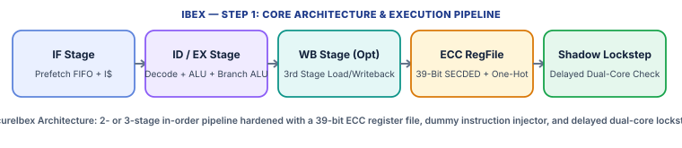

Ibex (originally developed as *Zero-riscy* at ETH Zürich PULP and now maintained by lowRISC) is a commercial-grade, 32-bit in-order RISC-V (`RV32IMC` / `RV32EMC` / `RV32B`) processor written in SystemVerilog. When explaining Ibex to someone, emphasize its flagship role: **Ibex is the CPU inside OpenTitan, the open-source Silicon Root-of-Trust (RoT) security chip**. Unlike general-purpose application cores that chase raw speed, Ibex is engineered specifically to survive a hostile physical attacker holding the chip on a laboratory bench—combining a clean 2-stage (or optional 3-stage) in-order pipeline with deep hardware countermeasures (`SecureIbex`) against timing side channels, power analysis, and laser/voltage fault injection.

| Architectural Property | Specification & Design Choice |
| :--- | :--- |
| **Base ISA & Extensions** | RV32I or RV32E; M (Multiply/Divide), C (Compressed), B (Bit Manipulation: Zba, Zbb, Zbc, Zbs), Zicsr, Zifencei, Zkt (Constant-Time) |
| **Pipeline Depth** | Configurable 2-stage (`IF` -> `ID/EX`) or 3-stage (`IF` -> `ID/EX` -> `WB` with `WritebackStage = 1`) in-order scalar pipeline |
| **Privilege Modes** | Machine Mode (`M-mode`) and User Mode (`U-mode`) for privilege separation |
| **Memory Protection** | Up to 16 regions of RISC-V PMP + **Smepmp (`mseccfg` Enhanced PMP)** for M-mode lockdown and whitelisting |
| **Security Hardening (`SecureIbex`)** | Dual-Core Lockstep, Data-Independent Timing, Dummy Instruction Insertion, Register/Cache/Bus SECDED ECC, ICache Scrambling, Shadow CSRs |
| **Verification Pedigree** | Industrial UVM verification with `riscv-dv`, formal property checking, and fault-injection simulation |

#### Step-by-Step Pipeline & Execution Walkthrough

* **1. Instruction Fetch Stage (`IF` — `ibex_if_stage`)**: A 2- or 3-entry Prefetch Buffer (`ibex_prefetch_buffer`) or optional 2-way Instruction Cache fetches 32-bit words over the instruction bus, aligns 16-bit compressed (`RVC`) and 32-bit uncompressed instructions, and feeds the instruction word to Decode. Optional static branch prediction (`BranchPredictor = 1`) predicts backward branches taken without any dynamic BTB state.
* **2. Instruction Decode & Execute Stage (`ID/EX` — `ibex_id_stage` + `ibex_ex_block`)**: In the single combined `ID/EX` stage, the decoder reads source operands from the 2-read-port Register File, dispatches arithmetic/logic/bit-manipulation operations to the ALU, runs multiplication/division in the `MD` block (`SingleCycle` or `Fast` 3-cycle multiplier; 37-cycle iterative divider), computes branch targets (using a dedicated `BranchTargetALU` when enabled), and initiates Load/Store requests through the Load-Store Unit (`ibex_load_store_unit`).
* **3. Optional Writeback Stage (`WB` — `ibex_wb_stage`)**: In the 2-stage configuration, loads stall `ID/EX` until data returns from memory. Enabling `WritebackStage = 1` adds a 3rd pipeline stage (`WB`) with a writeback bypass network so load data returns and register writes complete in `WB` while the next instruction already executes in `ID/EX`, boosting clock frequency and CPI.
* **4. Hardware Security Alert Integration**: Throughout all stages, hardware parity/ECC checkers, shadow CSR comparators, program-counter continuity trackers, and lockstep comparators monitor execution, asserting `alert_minor`, `alert_major_internal`, or `alert_major_bus` on the exact cycle any anomaly occurs.

### Step 2: Every Memory Section Used in Ibex

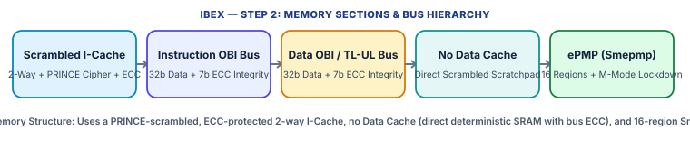

Ibex's memory subsystem is deliberately split into an optionally cached, cryptographically scrambled instruction stream and an uncached, deterministic, integrity-protected data stream—eliminating data-cache side channels while protecting every stored and transmitted bit with SECDED Error-Correcting Codes.

#### 2.1 Hardened Register File (`ibex_register_file_ff` / `latch` / `fpga`)

* 32 x 32-Bit (or 16 x 32-Bit) Organization: Provides 2 asynchronous read ports and 1 synchronous write port (with `x0` hardwired to zero).
* 39-Bit SECDED ECC & One-Hot Wordline Encoding (`RegFileECC = 1`): In `SecureIbex`, every 32-bit register is widened to **39 bits** by appending a **7-bit Hsiao SECDED (Single-Error Correcting, Double-Error Detecting) ECC syndrome** computed on write and checked on both read ports every cycle! Furthermore, register read/write address decoders use **one-hot encoding checks** so a voltage/laser glitch cannot cause two register wordlines to activate simultaneously.
* Writeback Stage Bypass Register: When `WritebackStage = 1`, an in-flight bypass register forwards results from `WB` to `ID/EX` without waiting an extra cycle.

#### 2.2 Instruction Fetch Buffer & Scrambled L1 Instruction Cache (`ibex_icache`)

* Prefetch FIFO (`ibex_prefetch_buffer`): A 2- or 3-word FIFO queue between the instruction bus and the RVC compressed decoder that hides bus latency on sequential code.
* Optional 2-Way Set-Associative Instruction Cache (`ICache = 1`): Typically configured as **4 KiB**, **2-way set-associative**, with **64-bit (8-byte) line beats / 32-byte lines**. For a 4 KiB, 2-way cache with 32-byte lines ($S = 64	ext{ sets}$): `Offset = 5 bits` (`addr[4:0]`), `Index = 6 bits` (`addr[10:5]`), and `Tag = 21 bits` (`addr[31:11]`).
* Cryptographic Scrambling (`ICacheScramble = 1`) & Tag/Data ECC (`ICacheECC = 1`): Both the Tag SRAM and Data SRAM of the I-Cache are protected by SECDED ECC and **cryptographically scrambled** using an ephemeral 128-bit key and the lightweight **PRINCE block cipher**! Address indices are non-linearly permuted (randomizing set mapping on every boot/rekey) and stored instruction words are XOR-masked with a keystream.

#### 2.3 Load-Store Unit (`ibex_load_store_unit`) & Absence of a Data Cache

* Zero Data Cache by Design: Ibex has **no L1 Data Cache (D$)**, no store buffer, and no MSHRs. All loads and stores go directly to on-chip Tightly Coupled Scratchpad SRAM (which in OpenTitan is also PRINCE-scrambled and ECC-protected).
* Hardware Misaligned Access Splitter: Unlike cores that trap to software on unaligned loads/stores, Ibex's LSU automatically splits any misaligned 32-bit word or 16-bit halfword access across two 32-bit word boundaries into **two sequential bus transactions** using appropriate 4-bit byte-enable strobes (`data_be_o[3:0]`).

#### 2.4 Instruction & Data Bus Interfaces (OBI / TileLink-UL with End-to-End Integrity)

* Separate Instruction (`instr_*`) and Data (`data_*`) Ports: Use a clean Open Bus Interface (OBI) request/grant/valid protocol (`req_o`, `gnt_i`, `rvalid_i`, `addr_o[31:0]`, `wdata_o`, `rdata_i`, `err_i`), bridged in OpenTitan to **TileLink Uncached Lightweight (`TL-UL`)**.
* End-to-End Bus Integrity (`MemECC = 1`): Instead of trusting the on-chip interconnect wires, Ibex generates and checks **7-bit ECC integrity syndromes** (`wdata_intg_o[6:0]`, `rdata_intg_i[6:0]`) right inside the CPU core! The 39-bit word travels undisturbed across the bus into the SRAM macro, catching any bus fault or active probing tamper.

#### 2.5 Physical Memory Protection (`PMP` + `Smepmp`) & Memory Ordering

* No Virtual Memory (No MMU / No TLB): Ibex uses physical addresses directly.
* 3-Channel Parallel PMP Checker (`ibex_pmp`): Supports up to **16 PMP regions** (`PMPNumRegions = 16`, supporting `OFF`, `TOR`, `NA4`, `NAPOT` address matching with `R`, `W`, `X`, and `L` [Lock] bits). Uniquely, Ibex instantiates **3 parallel PMP comparators**—two for instruction fetch (covering 32-bit instructions that straddle a 16-bit RVC boundary across two PMP regions!) and one for data loads/stores.
* Enhanced PMP (`PMPEnable = 1` + `Smepmp` / `mseccfg` CSR): Standard RISC-V PMP allows Machine Mode (`M-mode`) full access to any region unless the Lock (`L`) bit is set, and locked regions cannot be modified until reset. Ibex implements **Smepmp (`mseccfg` bits `MML` [Machine Mode Lockdown], `MMWP` [Machine Mode Whitelist Policy], and `RLB` [Rule Locking Bypass])**, enforcing strict `W^X` separation between `M-mode` and `U-mode` so even `M-mode` cannot execute user data or read/write unlisted physical addresses!
* Memory Ordering: Strictly in-order execution; `FENCE.I` invalidates the Prefetch Buffer and triggers a hardware re-key/flush of the scrambled I-Cache.

### Step 3: Security Mechanisms & How Ibex Prevents Attacks

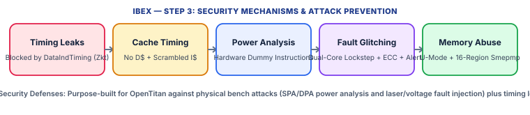

Ibex (`SecureIbex`) is the gold standard among open-source RISC-V cores for hardware security. Every microarchitectural block is engineered to defeat both software exploitation and physical laboratory attacks.

| Attack / Threat Vector | Core / SoC Mechanism Used | How It Prevents or Mitigates the Attack |
| :--- | :--- | :--- |
| **Timing Side-Channel Attacks (Variable-Latency `MUL`/`DIV`/Branch)** | `DataIndTiming` (`cpuctrlsts.data_ind_timing` / `Zkt` Extension) | Forces multi-cycle division (always 37 cycles), multiplication, and taken/not-taken branches to execute in an exact, data-independent cycle count. |
| **Cache-Timing Attacks (`Flush+Reload`, `Prime+Probe`, `Evict+Time`)** | Zero Data Cache + PRINCE-Scrambled I-Cache (`ICacheScramble`) | Data accesses never touch a cache (deterministic 1-cycle SRAM); I-Cache set mapping is randomized with an ephemeral PRINCE cipher key and flushed on `FENCE.I`. |
| **Spectre v1 / v2 / v4 & Meltdown (Transient Execution)** | 2/3-Stage Strictly In-Order Pipeline + Inline `ePMP` Gating | 100% Immune — No out-of-order execution, no dynamic BTB predictor, and `ePMP` blocks unauthorized bus requests (`data_req_o = 0`) on the exact cycle of address generation. |
| **Simple & Differential Power Analysis (`SPA` / `DPA` / `CPA`)** | Hardware Dummy Instruction Insertion (`DummyInstructions`) + Bus/SRAM Scrambling | An LFSR PRNG randomly injects fake ALU/Multiplier/Division operations with random registers every few cycles, desynchronizing power traces and masking Hamming weight. |
| **Physical Fault Injection (Voltage/Clock/EM/Laser Glitching)** | Delayed Dual-Core Lockstep (`ibex_lockstep`) + 39b RegFile/Bus ECC + Shadow CSRs + Hardened PC | A shadow Ibex core runs delayed by `LockstepOffset` cycles; any single-cycle mismatch in outputs, ECC, Shadow CSRs (`CSR != ~Shadow`), or PC sequence triggers `alert_major_internal`. |
| **Privilege Escalation & Code Injection (`W^X` Bypass)** | M/U Modes + 16-Region `Smepmp` (`MML` + `MMWP` Whitelist) | Prevents `M-mode` from executing `U-mode` pages or writing to `M-mode` code ROM, and denies access by default to any unconfigured physical address. |

#### 3.1 Defeating Timing Side-Channel Attacks (`DataIndTiming` & Constant-Time Hardware)

In standard embedded cores, `DIV`/`REM` instructions skip leading zeros, branches take fewer cycles when not-taken than when taken, and multipliers may early-out on zero operands—leaking secret cryptographic scalars via execution time. When software sets the `data_ind_timing` bit in Ibex's `cpuctrlsts` CSR: (1) the 37-cycle iterative divider disables all fast-paths and always executes the exact same 37 cycles regardless of divisor/dividend values; (2) not-taken conditional branches are artificially padded with stall cycles to match the exact cycle count of taken branches; and (3) all ALU/Bitmanip (`RV32B`/`Zkt`) instructions complete in fixed cycle counts.

#### 3.2 Defeating Cache-Timing Attacks (`Flush+Reload`, `Prime+Probe`, `Evict+Time`)

First, Ibex eliminates data-cache timing attacks (`Flush+Reload`, `Prime+Probe` on lookup tables) by having **no L1 Data Cache**—all data loads and stores access Tightly Coupled Scratchpad SRAM in deterministic time. Second, for instruction fetches when the 2-way I-Cache is enabled, `ICacheScramble` passes the fetch address through a keyed PRINCE cipher layer to randomize which addresses map to which cache sets, preventing an attacker from constructing a predictable eviction set for `Prime+Probe`, and supports atomic hardware key rotation + full invalidation on context switches.

#### 3.3 Defeating Speculative Execution Attacks (`Spectre` & `Meltdown`)

Ibex executes strictly in program order without a Reorder Buffer, Register Renaming, or dynamic branch target predictor. Even more importantly, in `ibex_core.sv`, the `ePMP` permission check (`pmp_req_err[PMP_D]`) gates the external bus request wire (`data_req_o`) combinatorially in the `ID/EX` stage: if a User-mode (`U-mode`) instruction attempts to read a Machine-mode (`M-mode`) secret address, the address never even leaves the core's `data_req_o` pin and triggers an immediate Load Access Fault—making Meltdown and Spectre physically impossible.

#### 3.4 Defeating Power & Electromagnetic Analysis (`SPA` / `DPA` / `CPA`)

To defeat oscilloscope power traces and EM probes on the bench, `SecureIbex` includes a hardware **Dummy Instruction Injector (`ibex_dummy_instr`)** seeded via an entropy CSR (`lfsr_seed`) connected to OpenTitan's hardware TRNG. At pseudo-random intervals (configurable every 1 to 64 instructions), the fetch stage stalls the real program for 1 cycle and injects a random fake instruction (`ADD`, `MUL`, `DIV`, or `AND`) reading two random registers from the Register File and discarding the destination write. This (1) randomly shifts real cryptographic operations in time so thousands of DPA traces cannot be aligned, and (2) injects uncorrelated switching noise across the 32-bit ALU and multiplier. Combined with PRINCE scrambling of data in SRAM (`sram_ctrl`), Hamming-weight leakage is heavily suppressed.

#### 3.5 Defeating Physical Fault Injection (`Voltage / Clock / Laser Glitching`)

An attacker with physical access may inject a nanosecond voltage dip or laser pulse to skip a secure-boot RSA/ECDSA signature verification branch (`BNE`) or flip a `PMP` permission bit. Ibex closes this with five interlocking hardware shields:
1. **Delayed Dual-Core Lockstep (`ibex_lockstep`)**: A second full Ibex core (**Shadow Core**) receives the exact same inputs through delay registers offset by $N$ clock cycles (`LockstepOffset`, e.g., 2–4 cycles), and its outputs are compared cycle-by-cycle against the main core's delayed outputs. A voltage or clock glitch hitting the chip at time $T$ perturbs the two cores at completely different instructions, guaranteeing an immediate comparator mismatch and asserting `alert_major_internal`!
2. **Shadow CSRs (`ibex_csr`)**: Critical security CSRs (`pmpaddr`, `pmpcfg`, `mseccfg`, `cpuctrlsts`) are stored twice—once normally and once bitwise-inverted (`~val`) in a shadow register—and compared on every clock cycle.
3. **Program Counter (`PC`) Continuity Check**: The `IF` and `ID/EX` stages track expected sequential/branch `PC` transitions; if a glitch forces `PC` to jump to an unpredicted address without a valid branch/jump enable, Ibex raises a fatal alert.
4. **Branch Target ALU (`BranchTargetALU = 1`)**: Separates branch target address calculation from the main ALU where branch condition comparison occurs, so a single ALU glitch cannot simultaneously force a condition true and corrupt the target address.
5. **End-to-End 39-Bit SECDED ECC (`RegFileECC` + `MemECC` + `ICacheECC`)**: Detects 1-bit and 2-bit laser/glitch faults across all registers, buses, and SRAMs.

## Core 4: [C-DAC VEGA Processor Family (ET1031, AT1051, AS1061, AS1161, AS2161/DHRUV64, AS4161)](https://vegaprocessors.in/)

* **Official Documentation**: [https://vegaprocessors.in/](https://vegaprocessors.in/)
* **Source Repository**: [https://gitlab.com/cdac-vega](https://gitlab.com/cdac-vega)

### Step 1: About the Core (How to Explain VEGA to Someone)

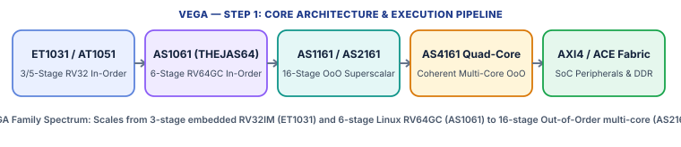

VEGA is a family of indigenous 32-bit and 64-bit RISC-V processor cores developed by **C-DAC (Centre for Development of Advanced Computing, India)** under the Digital India RISC-V (**DIR-V**) programme. When explaining VEGA to someone, the most important thing to clarify is that **VEGA is not a single core—it is a complete 6-core family** scaling from a tiny 3-stage microcontroller (`ET1031`, used in the `THEJAS32` chip on the ARIES board) to a 6-stage 64-bit Linux processor (`AS1061` in `THEJAS64`) and all the way up to 16-stage Out-of-Order superscalar single-, dual-, and quad-core processors (`AS1161`, `AS2161` / `DHRUV64`, and `AS4161`).

| Architectural Property | Specification & Design Choice |
| :--- | :--- |
| **ET1031 (Microcontroller)** | 32-bit `RV32IM` · 3-stage In-Order pipeline · AHB/AXI4 bus · Optional MMU · Powers the **THEJAS32** SoC (ARIES v3.0 board) |
| **AT1051 (Embedded / RTOS)** | 32-bit `RV32IMAFC` (with single-precision FPU) · 5-stage In-Order pipeline · AHB/AXI4 bus |
| **AS1061 (Application In-Order)** | 64-bit `RV64IMAFDC` (`RV64GC`) · 6-stage In-Order pipeline · 8 KB L1I + 8 KB L1D + MMU · Powers the **THEJAS64** SoC |
| **AS1161 (Single-Core OoO)** | 64-bit `RV64IMAFDC` · **16-stage Out-of-Order Superscalar** · 32 KB L1I + 32 KB L1D + MMU · AXI4 / ACE |
| **AS2161 / DHRUV64 (Dual-Core OoO)** | 64-bit `RV64IMAFDC` · Dual-Core 16-stage Out-of-Order · 32 KB L1I/L1D per core + **512 KB Shared L2** · ACE Coherent |
| **AS4161 (Quad-Core OoO)** | 64-bit `RV64IMAFDC` · Quad-Core 16-stage Out-of-Order · 32 KB L1I/L1D per core + **1 MB Shared L2** · ACE Coherent |

#### Step-by-Step Pipeline & Execution Walkthrough

* **1. Embedded In-Order Tier (`ET1031` 3-Stage & `AT1051` 5-Stage)**: `ET1031` uses a compact 3-stage pipeline (`Fetch -> Decode -> Execute/Memory/Writeback`) optimized for low power and deterministic control of UART, SPI, I2C, GPIO, PWM, and timers in `THEJAS32`. `AT1051` expands this to a classic 5-stage pipeline (`IF -> ID -> EX -> MEM -> WB`) and adds hardware single-precision floating-point (`F`) and compressed (`C`) instructions.
* **2. Linux Application In-Order Tier (`AS1061` 6-Stage)**: `AS1061` splits instruction fetch and memory access across a 6-stage single-issue in-order pipeline with dynamic branch prediction (BTB + BHT), an IEEE-754 single/double-precision FPU (`FD`), split 8 KiB L1 instruction and data caches, and a full `Sv39` Memory Management Unit (MMU) capable of booting 64-bit Linux on the `THEJAS64` SoC.
* **3. High-Performance Out-of-Order Tier (`AS1161`, `AS2161 / DHRUV64`, `AS4161` 16-Stage)**: The `AS1161/2161/4161` cores implement a deep **16-stage Out-of-Order superscalar pipeline** with multi-level branch prediction (BTB, BHT, and Return Address Stack `RAS`), register renaming onto physical register files, out-of-order issue queues, a Reorder Buffer (ROB) for precise in-order retirement, non-blocking 32 KiB L1 caches, and an **AMBA AXI4-ACE (AXI Coherency Extensions)** coherent interconnect uniting 2 cores (`AS2161` with 512 KiB L2) or 4 cores (`AS4161` with 1 MiB L2).

### Step 2: Every Memory Section Used in VEGA

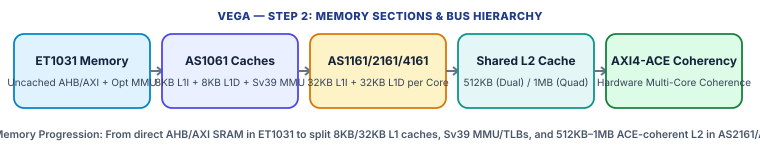

Because VEGA spans three microarchitectural classes, its memory subsystem scales from direct uncached AHB/AXI buses in `ET1031` to full multi-level ACE-coherent caches and MMUs in `AS2161`/`AS4161`.

#### 2.1 Register Files & Execution Buffers Across the Family

* In-Order Cores (`ET1031`, `AT1051`, `AS1061`): Architectural 32-entry Integer Register File (`x0`–`x31`, 32-bit in ET/AT, 64-bit in AS1061) plus a 32-entry Floating-Point Register File (`f0`–`f31`) in `AT1051` (32-bit) and `AS1061` (64-bit), with standard pipeline bypass forwarding.
* Out-of-Order Cores (`AS1161`, `AS2161`, `AS4161`): Architectural integer and floating-point registers are renamed onto larger **Physical Register Files** backed by a **Reorder Buffer (ROB)**, **Issue Queues**, and an out-of-order **Load/Store Queue (LSQ)** supporting store-to-load forwarding and speculative memory disambiguation.

#### 2.2 L1 Instruction & Data Caches

* `ET1031` (THEJAS32): Typically operates directly out of on-chip SRAM (e.g., 256 KiB SRAM in THEJAS32) and QSPI Flash over AHB/AXI4 without internal L1 caches.
* `AS1061` (THEJAS64): Features a **split 8 KiB L1 Instruction Cache (L1I)** and **8 KiB L1 Data Cache (L1D)** per core to feed its 6-stage pipeline.
* `AS1161` / `AS2161` / `AS4161`: Each core features a **32 KiB L1 Instruction Cache (L1I)** and a **32 KiB Non-Blocking L1 Data Cache (L1D)** with MSHRs and write buffers to support multiple in-flight out-of-order memory loads.

#### 2.3 Shared L2 Cache (`AS2161` & `AS4161` Multi-Core)

* Unified Cluster L2 Cache: `AS2161` (`DHRUV64` dual-core) integrates a **512 KiB Unified Shared L2 Cache**; `AS4161` (quad-core) integrates a **1 MiB Unified Shared L2 Cache**.
* Role in Hierarchy: Absorbs L1I and L1D misses from all cores in the cluster and interfaces to external DDR3/DDR4 memory controllers over wide AXI4 buses.

#### 2.4 Virtual Memory, MMU & TLBs

* Privilege Modes & Paging: `AS1061`, `AS1161`, `AS2161`, and `AS4161` implement full `M`/`S`/`U` privilege modes and a hardware **Memory Management Unit (MMU)** with split Instruction/Data TLBs and a hardware Page Table Walker (`Sv39` for 64-bit cores; optional `Sv32` MMU on `ET1031`).
* Page Permissions: Enforces standard RISC-V `R` (Read), `W` (Write), `X` (Execute), and `U` (User) page-table attributes along with `SFENCE.VMA` TLB shootdowns.

#### 2.5 Bus Protocols, Cache Coherence (`ACE`) & Memory Consistency (`RVWMO`)

* Single-Core Buses (`AHB` / `AXI4`): `ET1031`, `AT1051`, and `AS1061` use AMBA AHB-Lite and AXI4 master interfaces for instruction fetch, data memory, and peripheral MMIO (PLIC, CLINT, UART, SPI, Ethernet).
* Multi-Core Cache Coherence (`AMBA AXI4-ACE`): `AS2161` and `AS4161` extend AXI4 with **ACE (AXI Coherency Extensions)** snoop channels (`AC`, `CR`, `CD`), maintaining hardware cache coherence (MESI/MOESI) across the private 32 KiB L1D caches of the 2 or 4 cores and the shared 512 KiB / 1 MiB L2 cache.
* Memory Ordering: Follows **RVWMO**; `FENCE` orders data reads/writes across cores and `FENCE.I` synchronizes instruction caches with modified data.

### Step 3: Security Mechanisms & How VEGA Prevents Attacks

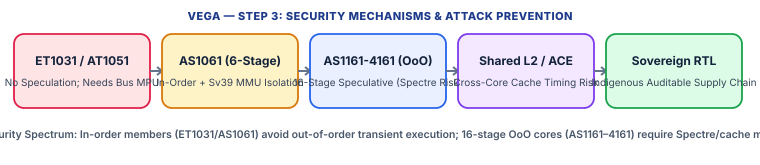

Analyzing security for VEGA requires contrasting its three microarchitectural tiers: the simple in-order `ET1031`, the Linux-capable in-order `AS1061`, and the 16-stage speculative out-of-order `AS1161`/`AS2161`/`AS4161`.

| Attack / Threat Vector | Core / SoC Mechanism Used | How It Prevents or Mitigates the Attack |
| :--- | :--- | :--- |
| **Process & OS Memory Isolation** | M/S/U Privilege Modes + Hardware MMU (`Sv39` / Opt `Sv32`) + PMP | `AS1061` and `AS1161–4161` enforce full virtual memory isolation (`R/W/X/U` page permissions) between user processes and the Linux kernel; `ET1031` without MMU requires an AHB/AXI peripheral firewall. |
| **Spectre v1 / v2 / v4 (Transient Execution)** | In-Order (`ET1031`/`AT1051`/`AS1061`) vs. 16-Stage OoO (`AS1161–4161`) | `ET1031`/`AT1051`/`AS1061` do not execute loads out-of-order; however, the 16-stage OoO `AS1161/2161/4161` speculate deeply past branches and unresolved stores, creating standard Spectre v1/v2/v4 exposure requiring software `FENCE` barriers and predictor flushing. |
| **Meltdown (Rogue Data Cache Load)** | MMU/TLB Permission Check in Load Pipeline | In-order cores (`ET1031`/`AS1061`) never forward faulting kernel loads; on OoO `AS1161–4161`, security depends on TLB privilege enforcement completing before speculative load forwarding (or OS KPTI). |
| **Cache-Timing Attacks (`Flush+Reload`, `Prime+Probe`, `Evict+Time`)** | Uncached SRAM (`ET1031`) vs. Shared 512KB/1MB L2 (`AS2161`/`AS4161`) | `ET1031` running from uncached SRAM has no cache-timing channel; `AS1061` has private 8KB L1s; dual/quad-core `AS2161`/`AS4161` share a 512KB/1MB ACE-coherent L2 where cross-core `Prime+Probe` and `Flush+Reload` are possible. |
| **Timing Side Channels** | Constant-Time Coding Required on Iterative MUL/DIV/FPU | None of the public VEGA briefs claim hardware data-independent timing (`Zkt`); cryptographic code must avoid secret-dependent branches, table lookups, and division. |
| **Physical Glitching, Power Analysis & Supply-Chain Trust** | Indigenous Auditable RTL (DIR-V); SoC-Level Crypto & Watchdogs | Provides national supply-chain auditability (preventing third-party hardware Trojans), while physical fault/power resistance requires external ECC, TRNGs, and secure-boot ROM verification. |

#### 3.1 Privilege & Memory Isolation Across VEGA Tiers

On the application cores (`AS1061`, `AS1161`, `AS2161`, `AS4161`), the hardware MMU and TLBs enforce page-granular `Read`, `Write`, `Execute`, and `User/Supervisor` permissions on every instruction fetch and load/store, isolating Linux user processes from each other and from the `S-mode` kernel. On the embedded `ET1031` (`THEJAS32`), when synthesized without the optional MMU, all firmware runs in `M-mode` across a flat 32-bit physical map; securing `ET1031` against untrusted peripheral or DMA accesses requires configuring physical memory protection (`PMP`) or an AHB/AXI address-range firewall in the SoC fabric.

#### 3.2 Why `ET1031`/`AS1061` Avoid Transient Attacks While `AS1161/2161/4161` Face Spectre Risks

Compare the pipeline depths across the VEGA family: `ET1031` (3 stages) and `AS1061` (6 stages) are **single-issue in-order cores**. They do not rename registers or speculatively issue dependent loads out of order ahead of unresolved branches, so classic **Spectre v1/v4** and **Meltdown** transient windows do not arise. By contrast, `AS1161`, `AS2161` (`DHRUV64`), and `AS4161` use a **16-stage out-of-order superscalar pipeline** with BTB/BHT/RAS branch predictors and non-blocking 32 KiB L1D caches. When the branch predictor mispredicts a bounds check (`Spectre v1`) or an indirect jump (`Spectre v2`), the 16-stage OoO engine speculatively executes loads into the 32 KiB L1D and 512 KiB / 1 MiB L2 cache before the branch resolves and squashes the ROB—leaving a measurable cache footprint. Defending `AS1161–4161` requires compiler speculation barriers (`FENCE`), index masking, and context-switch BTB/TLB flushing (`SFENCE.VMA`, `FENCE.I`).

#### 3.3 Cache-Timing Side Channels (`Prime+Probe` & `Flush+Reload` on Shared ACE L2)

On `ET1031` (`THEJAS32`), code and data reside in deterministic on-chip SRAM with no L1 cache, eliminating cache-timing leaks. On `AS1061`, the 8 KiB L1I and 8 KiB L1D caches can be probed by time-slicing processes on the same core unless flushed on context switches. On multi-core `AS2161` and `AS4161`, the cores share a **512 KiB or 1 MiB L2 cache** linked by an **AXI4-ACE coherent interconnect**. An attacker thread pinned to Core 1 can run cross-core `Prime+Probe` on the shared L2 sets or `Flush+Reload` on shared read-only library pages touched by a victim on Core 0, requiring OS core/page isolation or constant-time cryptographic software (avoiding S-Box lookup tables).

#### 3.4 Supply-Chain Security vs. Physical Side-Channel Hardening

A strategic security motivation for the C-DAC VEGA family is **sovereign silicon assurance**: because the RTL, SDK, and SoC integration (`THEJAS32`, `THEJAS64`, `DHRUV64`) are developed domestically and open to government/academic inspection, systems are protected against hidden backdoors or third-party IP hardware Trojans. However, because standard VEGA cores are not physical root-of-trust cores like `SecureIbex`, deployments facing physical fault injection or DPA power analysis must add SoC-level voltage/clock monitors, SRAM ECC, and dedicated masked cryptographic accelerators.

## Core 5: [OpenHW CORE-V CV32E40P (formerly PULP RI5CY)](https://docs.openhwgroup.org/projects/cv32e40p-user-manual/en/latest/intro.html)

* **Official Documentation**: [https://docs.openhwgroup.org/projects/cv32e40p-user-manual/en/latest/intro.html](https://docs.openhwgroup.org/projects/cv32e40p-user-manual/en/latest/intro.html)
* **Source Repository**: [https://github.com/openhwfoundation/cv32e40p](https://github.com/openhwfoundation/cv32e40p)

### Step 1: About the Core (How to Explain CV32E40P to Someone)

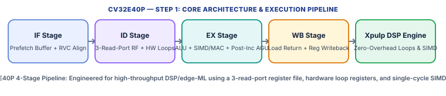

CV32E40P (originally developed at ETH Zürich and the University of Bologna as **PULP RI5CY**, and industrially verified by the **OpenHW Group**) is a 4-stage, in-order, 32-bit RISC-V (`RV32IMC` + optional `F`/`Zfinx`) processor core written in SystemVerilog. When explaining CV32E40P to someone, describe it as **the DSP and Edge-AI workhorse of embedded RISC-V**: while a standard 32-bit RISC-V core wastes many cycles incrementing array pointers and branching at the end of inner loops, CV32E40P adds custom **`Xpulp` (CORE-V)** extensions—including **zero-overhead hardware loops**, **register/immediate post-increment loads and stores**, **packed-SIMD (8-bit and 16-bit vector dot products)**, and **single-cycle Multiply-Accumulate (MAC)**—supported by a **3-read-port Register File**!

| Architectural Property | Specification & Design Choice |
| :--- | :--- |
| **Base ISA & Standard Extensions** | `RV32IMC`, `Zicsr`, `Zifencei`; optional single-precision `F` (FPU) and `Zfinx` (Floating-Point in Integer Registers) |
| **Custom DSP Extensions (`COREV_PULP=1`)** | `Xpulp` v2: 2 levels of Zero-Overhead Hardware Loops (`lp.setup`), Post-Increment Loads/Stores (`p.lw`), SIMD dot-product (`pv.dotsp`), Bit-Manip/MAC |
| **Pipeline Structure** | 4-stage in-order scalar pipeline (`1. IF -> 2. ID -> 3. EX -> 4. WB`) with full forwarding |
| **Register File Ports** | **3 Read Ports (`raddr_a`, `raddr_b`, `raddr_c`) + 2 Write Ports** to support `rd = rs1 * rs2 + rs3` (MAC) and post-increment stores in 1 cycle! |
| **Privilege & Protection** | Machine Mode (`M-mode`) only; no internal PMP, MMU, or caches (security sibling **CV32E40S** adds U-mode, Smepmp, and physical hardening) |
| **Bus Protocol** | Dual **OBI (Open Bus Interface)** master ports (`instr_req_o`/`gnt_i`/`rvalid_i` and `data_req_o`/`gnt_i`/`rvalid_i`) |

#### Step-by-Step Pipeline & Execution Walkthrough

* **1. Stage 1 — Instruction Fetch (`IF` — `cv32e40p_if_stage`)**: A 4-word Prefetch Buffer (`cv32e40p_prefetch_buffer`) fetches 32-bit words over the instruction OBI bus, aligns 16-bit compressed (`RVC`) and 32-bit instructions, and works directly with the **Hardware Loop Controller (`cv32e40p_hwloop_regs`)** so that when the Program Counter reaches the end address of an inner loop, `IF` jumps back to the loop start address with **zero branch stall cycles**!
* **2. Stage 2 — Instruction Decode (`ID` — `cv32e40p_id_stage`)**: Decodes standard `RV32IMCF` and `Xpulp` instructions, reads up to **3 source operands simultaneously** from the 3-read-port Register File (`rs1`, `rs2`, and `rs3`/`rd`), evaluates branch conditions (resolving conditional branches in `ID`/`EX`), and manages pipeline stalls/hazards.
* **3. Stage 3 — Execute & Address Generation (`EX` — `cv32e40p_ex_stage`)**: Contains the 32-bit ALU (with packed 8-bit/16-bit SIMD lanes), the single-cycle Multiplier/MAC unit and iterative Divider, the optional IEEE-754 `FPnew` Floating-Point Unit, and the Load-Store Unit (`cv32e40p_load_store_unit`) which computes effective addresses and issues data OBI requests.
* **4. Stage 4 — Writeback (`WB`)**: Receives read data returning from the data OBI bus (`data_rvalid_i`), performs sign/zero extension, and writes results back to the Register File (which has 2 write ports so a post-increment load can write both the loaded memory value into `rd` and the updated base pointer into `rs1` simultaneously!).

### Step 2: Every Memory Section Used in CV32E40P

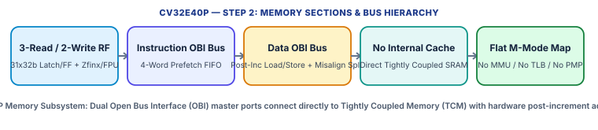

CV32E40P's memory structure is built for high-bandwidth, deterministic Tightly Coupled Memory (TCM) and multi-banked L1 cluster scratchpads (as used in PULP multi-core clusters), completely omitting internal caches and virtual memory.

#### 2.1 Multi-Port Register File (`cv32e40p_register_file_ff` / `latch`)

* 31 x 32-Bit General-Purpose Registers (`x1`–`x31`, `x0` hardwired to 0) + Optional 32 x 32-Bit FP Registers (`f0`–`f31`): When `ZFINX = 1`, floating-point instructions reuse the integer register file (`x1`–`x31`), saving 50% of register file area.
* 3 Read Ports & 2 Write Ports: Standard RISC-V cores have 2 read ports and 1 write port. CV32E40P provides **3 read ports** (to read base address `rs1`, offset register `rs2`, and store data `rs3` in a single cycle for indexed stores, or 3 operands for `MAC`) and **2 write ports** (so a post-increment load `p.lw rd, imm(rs1!)` writes the memory data to `rd` in `WB` at the same time `EX` writes `rs1 + imm` back to `rs1`).
* Hardware Loop Register File (`cv32e40p_hwloop_regs`): A dedicated miniature register file storing `LP_START[0:1]`, `LP_END[0:1]`, and `LP_COUNT[0:1]` for 2 nested hardware loops.

#### 2.2 Instruction Prefetch Buffer & OBI Instruction Interface

* 4-Entry x 32-Bit Prefetch FIFO (`cv32e40p_prefetch_buffer`): Decouples the OBI instruction bus handshake (`instr_req_o`, `instr_gnt_i`, `instr_rvalid_i`, `instr_addr_o[31:0]`, `instr_rdata_i[31:0]`) from the pipeline and buffers sequential words across hardware loop back-edges.
* No Internal L1 Instruction Cache: CV32E40P connects directly to single-cycle Tightly Coupled Instruction SRAM (TCM) or to an external cluster instruction cache.

#### 2.3 Load-Store Unit (`cv32e40p_load_store_unit`) & OBI Data Interface

* Post-Increment & Register-Indexed Addressing: Supports standard `imm(rs1)` addressing plus `Xpulp` post-increment immediate `imm(rs1!)`, post-increment register `rs2(rs1!)`, and register-offset `rs2(rs1)` modes.
* Hardware Misaligned Access Engine: Automatically detects any 32-bit word or 16-bit halfword access that crosses a 32-bit word boundary and splits it in hardware into **two consecutive OBI bus transfers**, reassembling the 32-bit word transparently without raising a software trap.
* No Internal L1 Data Cache: All loads and stores traverse the OBI data port (`data_req_o`, `data_gnt_i`, `data_rvalid_i`, `data_we_o`, `data_be_o[3:0]`, `data_addr_o[31:0]`) directly to Tightly Coupled Data SRAM or a multi-banked TCDM (Tightly Coupled Data Memory) logarithmic interconnect.

#### 2.4 Absence of MMU/TLB/PMP & Memory Ordering

* Flat Physical Addressing (`M-Mode` Only): CV32E40P has no MMU, no TLB, and no PMP unit. Every 32-bit address is physical.
* Memory Ordering: Strictly in-order load/store issue; `FENCE` is a no-op (as there is no store buffer reordering accesses) and `FENCE.I` flushes the 4-word instruction prefetch buffer.

### Step 3: Security Mechanisms & How CV32E40P Prevents Attacks

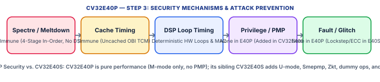

In the OpenHW CORE-V family, **CV32E40P is the pure DSP/performance core**, whereas its sister core **CV32E40S** is the security-hardened variant. Understanding CV32E40P's security means knowing what its 4-stage uncached pipeline naturally prevents (Spectre, Meltdown, and cache timing) versus what must be added at the SoC level (or by switching to CV32E40S).

| Attack / Threat Vector | Core / SoC Mechanism Used | How It Prevents or Mitigates the Attack |
| :--- | :--- | :--- |
| **Spectre v1 / v2 / v4 & Meltdown (Transient Execution)** | 4-Stage In-Order Pipeline + No Data Cache + No Speculative Load Issue | 100% Immune — Branches resolve before any younger instruction can alter a cache; no out-of-order ROB or speculative load forwarding exists. |
| **Cache-Timing Attacks (`Flush+Reload`, `Prime+Probe`, `Evict+Time`)** | Zero Internal Caches (Direct Single-Cycle OBI Scratchpad TCM) | 100% Immune Inside Core — Deterministic TCM access has no cache hit/miss timing differential. |
| **Loop-Branch & Array-Indexing Timing Leaks** | Hardware Loops (`lp.setup`) + Single-Cycle Packed SIMD/MAC | Hardware loops eliminate data-independent loop-branch overhead and single-cycle MAC/ALU instructions run in fixed 1-cycle latency (though iterative `DIV` and `FPU` remain data-dependent). |
| **Privilege Escalation & Unauthorized Memory Access** | None Inside CV32E40P (`M-Mode` Only, No `PMP`, No `MMU`) | Vulnerable to rogue firmware inside the core — requires an external OBI Bus Firewall / MPU (or upgrading to **CV32E40S**, which adds `U-mode` and 16-region `Smepmp`). |
| **Physical Fault Injection (`Glitching`) & Power Analysis (`SPA`/`DPA`)** | None Inside CV32E40P (No Register ECC, No Lockstep, No Dummy Ops) | Vulnerable to physical glitching — requires SoC-level lockstep/ECC or switching to **CV32E40S** (which adds Dual-Core Lockstep, `Zkt`, Dummy Instructions, and Bus/RF ECC). |

#### 3.1 Natural Immunity to Speculative (`Spectre`/`Meltdown`) and Cache-Timing Attacks

Because CV32E40P is a 4-stage in-order scalar pipeline (`IF -> ID -> EX -> WB`) with no dynamic branch target buffer (BTB), no out-of-order execution, and no internal data cache, it never issues speculative loads into a cache hierarchy. Consequently, `Spectre v1/v2/v4`, `Meltdown`, `Flush+Reload`, `Prime+Probe`, and `Evict+Time` do not affect CV32E40P.

#### 3.2 Timing Side-Channel Behavior of `Xpulp` DSP Extensions

CV32E40P's single-cycle 32-bit multiplier, single-cycle MAC (`p.mac`), packed-SIMD dot-product units (`pv.dotsp`), and zero-overhead hardware loops execute with deterministic 1-cycle latency, which helps DSP and constant-time symmetric crypto routines avoid branch penalties. However, the iterative integer divider (`DIV`/`REM`), optional `FPnew` floating-point unit, and misaligned two-transfer load/store splitter have operand- or address-dependent latencies. Cryptographic code on CV32E40P must align all secret buffers to 32-bit boundaries and avoid hardware division on secrets.

#### 3.3 Architectural Isolation Gap (Why `M-Mode`-Only Requires an OBI Firewall or `CV32E40S`)

CV32E40P implements only Machine Mode (`M-mode`) and omits both `PMP` and an `MMU`. Any task or RTOS thread running on CV32E40P can read or write any address on the OBI data bus and access all CSRs. To secure an SoC using CV32E40P:
1. **External OBI Bus MPU / Firewall**: Place a memory protection unit on `instr_addr_o` and `data_addr_o` to enforce read-only code regions (`W^X`) and isolate peripheral/crypto key registers.
2. **Lock the RISC-V Debug Module**: Gate `debug_req_i` via one-time-programmable (OTP) lifecycle fuses in production silicon.
3. **Drop-In Upgrade to OpenHW `CV32E40S`**: When a project needs in-core hardware security with the same 4-stage OBI footprint, OpenHW provides **CV32E40S**, which drops `Xpulp`/`FPU` and adds `U-mode`, up to 16 regions of **Smepmp (`ePMP`)**, **Data-Independent Timing (`Zkt`)**, **LFSR Dummy Instruction Insertion**, **Register File & Bus ECC**, **Hardened PC/Control Flow**, and **Dual-Core Lockstep**.

## Core 6: [UC Berkeley Rocket Core (Chipyard / Rocket Chip Generator)](https://chipyard.readthedocs.io/en/1.14.0/Generators/Rocket.html)

* **Official Documentation**: [https://chipyard.readthedocs.io/en/1.14.0/Generators/Rocket.html](https://chipyard.readthedocs.io/en/1.14.0/Generators/Rocket.html)
* **Source Repository**: [https://github.com/chipsalliance/rocket-chip](https://github.com/chipsalliance/rocket-chip)

### Step 1: About the Core (How to Explain Rocket Core to Someone)

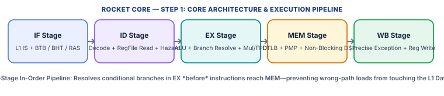

Rocket Core, developed at UC Berkeley in the **Chisel** hardware construction language and maintained by CHIPS Alliance (`rocket-chip` / **Chipyard**), is the canonical **5-stage, single-issue, in-order RISC-V (`RV64GC` / `RV32GC`)** processor that powers commercial SiFive E/S/U-series cores and hundreds of research chips. When explaining Rocket to someone, describe it as **the classic textbook 5-stage RISC pipeline (`IF -> ID -> EX -> MEM -> WB`) scaled up to run full 64-bit Linux across coherent multi-core SoCs**. Unlike tiny embedded cores (SERV, PicoRV32, CV32E40P), Rocket includes dynamic branch prediction (`BTB`, `BHT`, `RAS`), IEEE-754 double-precision floating-point (`FPU`), a full `Sv39`/`Sv48` virtual memory MMU with TLBs, a **non-blocking L1 Data Cache (`HellaCache`)**, and a coherent **TileLink** interconnect.

| Architectural Property | Specification & Design Choice |
| :--- | :--- |
| **Base ISA & Extensions** | `RV64GC` (`RV64IMAFDC`) or `RV32GC`, `Zicsr`, `Zifencei`, plus optional `RoCC` (Rocket Custom Coprocessor) accelerator interface |
| **Pipeline Structure** | 5-stage single-issue in-order scalar pipeline: `1. Fetch (IF) -> 2. Decode (ID) -> 3. Execute (EX) -> 4. Memory (MEM) -> 5. Writeback (WB)` |
| **Privilege & Virtual Memory** | Machine (`M`), Supervisor (`S`), and User (`U`) modes; **Sv39** (3-level) or **Sv48** (4-level) paged virtual memory (`satp` CSR) |
| **Physical Memory Protection** | Configurable **8 to 16 RISC-V PMP** regions (`pmpaddr`/`pmpcfg`) checked on every translated physical address |
| **Cache & Interconnect** | VIPT L1 I$ (or `ITIM` scratchpad), Non-Blocking L1 D$ (`HellaCache` or `DTIM`), and **TileLink Cached (`TL-C`)** MESI coherence to shared L2 |
| **Long-Latency Scoreboarding** | In-order issue with a simple completion scoreboard for non-blocking load misses, iterative `DIV`/`SQRT`, and `RoCC` instructions |

#### Step-by-Step Pipeline & Execution Walkthrough

* **1. Stage 1 — Instruction Fetch (`IF`)**: Accesses the L1 Instruction Cache (and L1 ITLB in parallel via VIPT indexing) while querying the Branch Target Buffer (`BTB`), two-level Branch History Table (`BHT`), and Return Address Stack (`RAS`) to predict the next `PC` every cycle.
* **2. Stage 2 — Instruction Decode & Register Read (`ID`)**: Decodes the 16-bit or 32-bit instruction, reads 64-bit integer registers (`x1`–`x31`) or floating-point registers (`f0`–`f31`), and checks the scoreboard for data hazards (stalling `ID` on a 1-cycle load-use hazard or unreadiness of a long-latency `DIV`/`RoCC` destination register).
* **3. Stage 3 — Execute & Branch Resolution (`EX`)**: The 64-bit ALU performs arithmetic/logic operations, calculates the effective virtual address (`rs1 + imm`) for loads and stores, and **evaluates all conditional branches (`BEQ`, `BNE`, `BLT`, `BGE`)**. If the branch prediction from `IF` was wrong, `EX` immediately squashes the wrong-path instructions in `ID` and `IF` and redirects `PC`—**before any wrong-path instruction ever reaches the `MEM` stage!**
* **4. Stage 4 — Memory Access (`MEM`)**: Sends the virtual address from `EX` to the L1 Data Cache (`HellaCache`) and L1 Data TLB (`DTLB`). The `DTLB` translates the virtual page number to a physical page number and verifies both Page Table (`R/W/X/U`) and physical `PMP` permissions. If the access faults, the load/store is annulled.
* **5. Stage 5 — Writeback & Precise Commit (`WB`)**: Commits exceptions precisely in program order (updating `mepc`/`sepc` and `mcause`/`scause`), writes ALU or hitting load results into the Register File, and forwards results back to `EX` via full `MEM -> EX` and `WB -> EX` bypass muxes.

### Step 2: Every Memory Section Used in Rocket Core

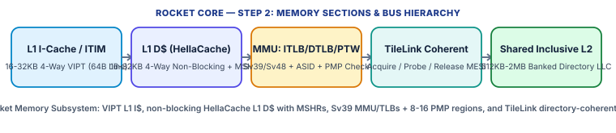

Rocket's memory subsystem (part of the Rocket Tile in Chipyard) is a complete, parameterizable multi-level coherent hierarchy uniting VIPT L1 caches, optional deterministic scratchpads (`ITIM`/`DTIM`), hardware page-table walking, and TileLink directory coherence.

#### 2.1 Architectural Register Files & Long-Latency Scoreboard

* 31 x 64-Bit Integer Registers + 32 x 64-Bit Floating-Point Registers: Read in `ID` and written in `WB` with full bypass paths (`EX -> EX`, `MEM -> EX`) so back-to-back ALU instructions suffer zero stall cycles.
* 32-Bit Scoreboard Bitmap: Tracks registers awaiting completion of variable-latency operations (non-blocking L1D misses via MSHRs, unpipelined integer division, FPU division/square-root, or `RoCC` coprocessor responses). Subsequent instructions that do *not* read or overwrite the pending register can continue executing while the miss resolves!

#### 2.2 L1 Instruction Cache (L1I) & Optional `ITIM` Scratchpad

* Default Organization: **16 KiB or 32 KiB**, **4-way set-associative**, **64-byte cache lines**.
* Address Decomposition (16 KiB, 4-way, 64B line = 64 sets): `Offset = 6 bits` (`addr[5:0]`), `Index = 6 bits` (`addr[11:6]`), `Tag = Physical Address[P-1:12]`. Because `6 + 6 = 12 bits` fit inside the 12-bit 4 KiB page offset (`addr[11:0]`), the L1I is **VIPT (Virtually Indexed, Physically Tagged)** with zero virtual aliasing!
* Optional `ITIM` (Instruction Tightly Integrated Memory): By configuring a way of the L1I SRAM with a base physical address, software can lock time-critical or security-critical routines into deterministic on-chip instruction scratchpad memory that is never evicted.

#### 2.3 L1 Data Cache (`HellaCache`) & Optional `DTIM` Scratchpad

* Organization & Write Policy: **16 KiB or 32 KiB**, **4-way set-associative**, **64-byte cache lines**, **VIPT**, **Write-Back, Write-Allocate**.
* Non-Blocking MSHRs (`Miss Status Holding Registers`): Unlike simple blocking caches, `HellaCache` can be configured with **2 to 4 MSHRs** (`nMSHRs`). On an L1D miss, the MSHR records the missing physical block address and target register while `HellaCache` continues servicing subsequent L1D hits ('hit under miss' and 'miss under miss').
* Store Buffer, AMO ALU & LR/SC Reservation Set: Uncommitted stores wait in the `MEM`/`WB` store pipeline until exceptions are ruled out in `WB`, then write into the L1D SRAM. An integrated **Atomic Memory Operation (AMO) ALU** executes `AMOSWAP`, `AMOADD`, `AMOXOR`, and `LR.D`/`SC.D` reservations directly inside the cache controller.
* Optional `DTIM` (Data Tightly Integrated Memory): Allows a portion or the entirety of the L1D SRAM to operate as an explicitly addressed, deterministic data scratchpad.

#### 2.4 Virtual Memory: ITLB, DTLB, Page-Table Walker (`PTW`) & `PMP`

* L1 ITLB & L1 DTLB: Separate 32-entry (sectored/fully associative) L1 Instruction and Data TLBs plus superpage entries (for 2 MiB megapages and 1 GiB gigapages), tagged with **Address Space Identifiers (`ASID`)** from `satp`.
* Hardware Page Table Walker (`PTW`) with Page-Walk Cache (`PWC`): On an ITLB or DTLB miss, a shared finite-state machine `PTW` walks the 3-level **Sv39** (or 4-level **Sv48**) page table in memory (via the L1D port) and caches intermediate Page Directory entries (`PTE` pointers) in a small Page-Walk Cache to accelerate translations.
* Inline `PMP` Physical Permission Check: Every TLB entry stores pre-computed **Physical Memory Protection (`PMP`)** permission bits (`R/W/X`) verified against the 8–16 `pmpaddr`/`pmpcfg` CSRs.

#### 2.5 Shared L2 Cache, `TileLink` MESI Coherence & `RVWMO` Consistency

* TileLink Cached (`TL-C`) Protocol: Rocket's L1D and L1I connect to the Chipyard system fabric via **TileLink** channels (`A: Acquire`, `B: Probe`, `C: Release/ProbeAck`, `D: Grant`, `E: GrantAck`), implementing a deadlock-free **MESI** cache coherence protocol.
* Shared Banked Inclusive L2 Cache (`sifive-blocks` InclusiveCache): Typically **512 KiB to 2 MiB** (8-way or 16-way, 64B lines), strictly **inclusive** of all Rocket L1 caches, using its tag array as a **coherence directory** so snoop `Probe` messages are sent only to cores that hold a copy of the cache line.
* Memory Consistency (`RVWMO`): Because Rocket issues instructions in order, loads and stores enter `HellaCache` in program order; only non-blocking MSHR miss completions can reorder accesses to different cache lines, which software serializes using `FENCE`, `FENCE.I`, and `SFENCE.VMA`.

### Step 3: Security Mechanisms & How Rocket Core Prevents Attacks

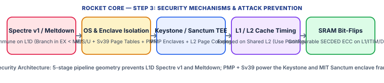

Rocket Core demonstrates one of the most important architectural security lessons in computer design: **how 5-stage in-order pipeline geometry naturally blocks data-cache Spectre v1 and Meltdown**, while making Rocket the foundational hardware platform for open-source Trusted Execution Environments (**Keystone** and **MIT Sanctum**).

| Attack / Threat Vector | Core / SoC Mechanism Used | How It Prevents or Mitigates the Attack |
| :--- | :--- | :--- |
| **Meltdown (Rogue Data Cache Load) & Foreshadow (L1TF)** | 5-Stage Pipeline + Synchronous DTLB/PMP Fault in `MEM` Stage | 100% Immune — Faulting loads are annulled in `MEM`/`WB` and never forward unauthorized kernel or non-present page data to younger instructions. |
| **Spectre v1 (Bounds Check Bypass on L1 Data Cache)** | Branch Resolution in `EX` (Stage 3) Precedes L1D Access in `MEM` (Stage 4) | Immune on L1D — When a branch resolves in `EX`, the younger instruction is still in `ID` and is squashed *before* it ever reaches `MEM` to touch `HellaCache`! |
| **Instruction-Cache Speculation (`IF` before `EX`)** | 2-Stage Fetch-to-Execute Window (`IF`/`ID` ahead of `EX`) | A mispredicted branch in `IF` can trigger up to 2 speculative instruction fetches into L1I/ITLB before `EX` squashes them; mitigated by `FENCE.I` / ITIM / predictor flush. |
| **Cache-Timing Attacks (`Prime+Probe`, `Flush+Reload` on L1/L2)** | Shared L1 (Time-Slicing) & Shared Inclusive L2 (Cross-Core) | Standard L1/L2 caches are vulnerable to `Prime+Probe`; solved in Rocket via `ITIM`/`DTIM` scratchpads or **MIT Sanctum / Keystone** L2 page coloring (set partitioning) and context-switch L1 flushes. |
| **OS & Enclave Memory Isolation** | `M/S/U` Modes + `Sv39` Page Tables + 8–16 Region Hardware `PMP` | Powers the **Keystone Enclave** framework: `M-mode` Security Monitor dynamically configures locked `PMP` regions to isolate enclaves even from a compromised Linux kernel. |
| **SRAM Bit-Flips & Fault Injection** | Configurable SECDED ECC / Parity on L1I, L1D (`HellaCache`), and L2 | Rocket Chip generator supports full SECDED ECC on tag and data SRAM arrays (`Code` parameter in `DCacheParams`/`ICacheParams`) to detect/correct soft errors and bit-flip glitches. |

#### 3.1 Why Rocket's 5-Stage Pipeline Geometry Blocks L1D Spectre v1 and Meltdown

Trace the exact stages of Rocket's pipeline (`IF -> ID -> EX -> MEM -> WB`) during a Spectre v1 attack (`if (x < array1_size) y = array2[array1[x] * 4096];`):
1. When the conditional branch (`BLTU x, size`) is in **Stage 3 (`EX`)**, the first wrong-path load inside the `if`-body (`LD t0, array1[x]`) is only in **Stage 2 (`ID`)**.
2. The L1 Data Cache (`HellaCache`) is not accessed until **Stage 4 (`MEM`)**!
3. In that exact clock cycle in Stage 3 (`EX`), the ALU finishes comparing `x < size`, detects the branch misprediction, and immediately asserts the pipeline kill signal (`ctrl_killd`), turning the wrong-path `LD` in `ID` into a `NOP` bubble *before it ever enters `MEM` or sends an address to the L1 Data Cache*!
4. Similarly, for **Meltdown**, if a User-mode (`U-mode`) load in `MEM` accesses a Supervisor (`S-mode`) kernel page, the `DTLB` raises a Load Page Fault in `MEM`, blocks the result in `WB`, and flushes younger instructions—so illegal kernel data can never be forwarded to a dependent load.

#### 3.2 What Minor Speculation *Does* Occur in Rocket (L1I / BTB / Non-Blocking MSHRs)

While Rocket never issues speculative loads to the L1 Data Cache past an unresolved branch, two narrower microarchitectural channels exist:
1. **Instruction Fetch Speculation (L1I & ITLB)**: Because `IF` uses the `BTB`/`BHT`/`RAS` to fetch instructions 2 cycles before branches resolve in `EX`, a mispredicted branch can bring 1–2 wrong-path instruction cache lines into the L1 Instruction Cache.
2. **Load-Miss Shadow (`HellaCache` MSHRs)**: If an older load misses in L1D (allocating an MSHR) and does *not* fault in the DTLB, Rocket's scoreboard allows subsequent independent instructions to continue executing until a register dependency or branch stall occurs.

#### 3.3 Defeating Cache-Timing Attacks (`Prime+Probe` & `Flush+Reload`) with `ITIM`/`DTIM`, `Sanctum`, and `Keystone`

On a multi-core Rocket SoC, all cores share the banked inclusive L2 cache, allowing a malicious thread on Core 1 to run `Prime+Probe` on shared L2 sets or time-sliced L1 sets. Rocket provides three architectural defenses:
1. **Hardware `ITIM` and `DTIM` Scratchpads**: By placing cryptographic keys, S-Boxes, and critical code inside Rocket's Tightly Integrated Memories (`ITIM` / `DTIM`), accesses bypass cache replacement entirely with deterministic latency.
2. **MIT Sanctum (Hardware Cache Partitioning on Rocket)**: Modifies Rocket's L2 address indexing and Page Table Walker to enforce **DRAM Page Coloring**, assigning each enclave and the OS strictly disjoint L2 cache sets so cross-core `Prime+Probe` is physically impossible, while adding a hardware CSR to flush L1I, L1D, TLB, and BTB on enclave transitions.
3. **UC Berkeley Keystone Enclave Framework**: Uses standard unmodified Rocket hardware by leveraging the `M-mode` **Security Monitor (SM)** and **8–16 hardware `PMP` regions** to carve out isolated physical DRAM enclaves inaccessible to the untrusted `S-mode` Linux OS, paired with software way-partitioning (`DAWG`) in the inclusive L2 cache.

## Core 7: [Western Digital / CHIPS Alliance VeeR EH1 (SweRV EH1)](https://github.com/chipsalliance/Cores-VeeR-EH1)

* **Official Documentation**: [https://github.com/chipsalliance/Cores-VeeR-EH1](https://github.com/chipsalliance/Cores-VeeR-EH1)
* **Source Repository**: [https://github.com/chipsalliance/Cores-VeeR-EH1](https://github.com/chipsalliance/Cores-VeeR-EH1)

### Step 1: About the Core (How to Explain SweRV EH1 (VeeR EH1) to Someone)

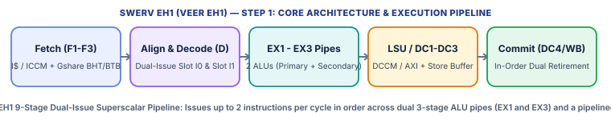

VeeR EH1 (originally introduced by Western Digital as **SweRV EH1** and now hosted by the **CHIPS Alliance**) is a high-performance, 32-bit, **9-stage, dual-issue (2-wide superscalar), in-order** RISC-V (`RV32IMC` + `Zba`/`Zbb`/`Zbs`) processor written in SystemVerilog. When explaining SweRV / VeeR EH1 to someone, highlight two clever engineering choices that give it near-out-of-order performance (4.9 CoreMark/MHz) without out-of-order hardware complexity or data-cache security risks:
1. **Dual-Issue In-Order Superscalar with Early & Late ALUs**: It decodes and issues up to **2 instructions per clock cycle** in program order (`Pipe 0` and `Pipe 1`), and places **two pairs of ALUs** at *both* the start (`EX1`, Stage 4) and the end (`EX3` / `DC3`, Stage 6) of the execution pipeline! If a second instruction depends on a load or an earlier ALU result, it doesn't stall the pipeline—it simply waits and executes in the late ALU (`EX3`) right after the load data returns!
2. **ECC-Protected Closely Coupled Memories (`ICCM` & `DCCM`) Instead of a Data Cache**: Built for enterprise NVMe SSD controllers and storage SoCs (and evolved into `VeeR EL2` inside the industry-standard **Caliptra** Silicon Root-of-Trust), EH1 replaces a traditional L1 Data Cache with a multi-banked, deterministic, **SECDED ECC-protected Data Closely Coupled Memory (`DCCM`)**.

| Architectural Property | Specification & Design Choice |
| :--- | :--- |
| **Base ISA & Extensions** | `RV32IMC`, `Zicsr`, `Zifencei`, plus Bit-Manipulation extensions (`Zba`, `Zbb`, `Zbs`) |
| **Pipeline Architecture** | **9-stage, 2-way superscalar (dual-issue), in-order** pipeline (`F1 -> F2 -> F3 -> D -> EX1/DC1 -> EX2/DC2 -> EX3/DC3 -> Commit/DC4 -> WB`) |
| **Execution Units** | **4 ALUs** (2 Primary ALUs in `EX1` + 2 Secondary ALUs in `EX3`), 1 pipelined 3-cycle Multiplier (`EX1–EX3`), 1 out-of-pipe 34-cycle Divider, 1 Load/Store pipe (`DC1–DC3`) |
| **Branch Prediction** | Gshare Branch History Table (`BHT`, up to 2,048 entries), Branch Target Buffer (`BTB`, 32–512 entries), and Return Address Stack (`RAS`) |
| **Privilege & Interrupts** | Machine Mode (`M-mode`) with integrated low-latency vectored **Programmable Interrupt Controller (`PIC`)** supporting up to 255 interrupt sources |
| **Memory Architecture** | 4–512 KiB **ICCM** (with SECDED ECC), 4–512 KiB 8-bank **DCCM** (with SECDED ECC), optional 16–256 KiB 4-way **L1 I-Cache** (Parity/ECC), **No Data Cache** |

#### Step-by-Step Pipeline & Execution Walkthrough

* **1. Stages 1–3 — Pipelined Instruction Fetch (`F1 -> F2 -> F3`)**: The Instruction Fetch Unit (`IFU`) fetches up to 64 bits (up to four 16-bit RVC or two 32-bit instructions) per cycle from either the **ICCM** or the **L1 I-Cache** (or external AXI4/AHB bus), guided by the Gshare `BHT`, `BTB`, and `RAS`, and places them into an Alignment Queue.
* **2. Stage 4 — Decode & Dual-Issue Pairing (`D`)**: The decoder inspects the oldest two instructions (`I0` and `I1`), reads up to 4 source operands from the **4-read-port, 3-write-port Register File**, and issues both instructions simultaneously if structural rules allow (up to 2 ALU ops, or 1 ALU op + 1 Load/Store, or 1 ALU op + 1 Multiply).
* **3. Stages 5–7 — Dual-Depth Execution & Load/Store (`EX1/DC1 -> EX2/DC2 -> EX3/DC3`)**: Independent instructions execute immediately in the **Primary ALUs (`EX1`)**, resolving branches in `EX1` (4-cycle mispredict penalty) or `EX3` (6-cycle penalty for load-dependent branches!). Meanwhile, loads and stores flow through `DC1` (address generation + TLB-free region check), `DC2` (8-bank **DCCM** SRAM read + SECDED ECC check), and `DC3` (data alignment + store buffer / forwarding). Instructions that depended on a load in `I0` execute in the **Secondary ALUs (`EX3`)** in Stage 7 with **zero load-use stall penalty**!
* **4. Stages 8–9 — In-Order Commit (`DC4`) & Writeback (`WB`)**: Stage 8 (`DC4`) validates exceptions and ECC statuses and commits up to 2 instructions in program order (committing stores from the Store Buffer into the DCCM banks), and Stage 9 (`WB`) writes results into the Register File.

### Step 2: Every Memory Section Used in SweRV EH1 (VeeR EH1)

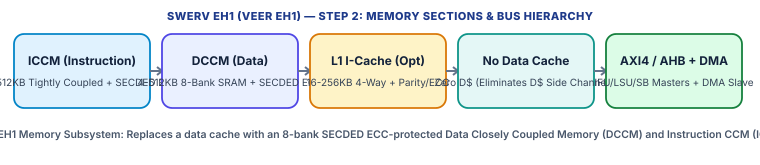

VeeR EH1's memory subsystem is explicitly engineered for deterministic, sub-nanosecond embedded storage and security workloads—using banked, ECC-protected Closely Coupled Memories (`ICCM` and `DCCM`) and a non-blocking AXI4 bus unit rather than a data cache.

#### 2.1 Multi-Port Register File (4 Read Ports / 3 Write Ports)

* 31 x 32-Bit General-Purpose Registers (`x1`–`x31`): Built from high-speed flip-flops with **4 concurrent read ports** (2 for Slot `I0`, 2 for Slot `I1`) and **3 concurrent write ports** (Slot `I0`, Slot `I1`, and non-blocking external AXI load/divide completion), plus a 10-source bypass forwarding network across `EX1`, `EX2`, `EX3`, `DC3`, `DC4`, and `WB`.

#### 2.2 Instruction Closely Coupled Memory (`ICCM`) & Optional L1 Instruction Cache (`I-Cache`)

* ICCM (Deterministic Instruction Scratchpad): Configurable from **4 KiB to 512 KiB**, organized into 4 or 8 interleaved 32-bit/64-bit SRAM banks for single-cycle, zero-miss instruction fetching. Protected on every word by a **7-bit SECDED ECC code (39 bits per 32-bit word)** that automatically corrects single-bit soft errors in hardware and raises a precise NMI/exception on double-bit errors.
* L1 Instruction Cache (`icache`): Configurable from **16 KiB to 256 KiB**, **4-way set-associative**, **64-byte cache lines** (with two 64-bit banks per way), protected by configurable **Parity or SECDED ECC** on both tag and data arrays. When a parity/ECC error is detected on a clean I-Cache line, hardware automatically invalidates the corrupted line and re-fetches a fresh copy from main memory ('hit-as-miss' auto-recovery)!

#### 2.3 Data Closely Coupled Memory (`DCCM`) & Absence of a Data Cache

* DCCM (8-Bank Deterministic Data Scratchpad): Configurable from **4 KiB to 512 KiB** (commonly 64 KiB), interleaved across **8 independent 32-bit SRAM banks** (`addr[4:2]` selects the bank) so concurrent CPU loads, stores, and DMA accesses rarely collide on the same bank!
* Hardware SECDED ECC Read-Modify-Write Scrubbing: Every 32-bit word in DCCM carries **7 bits of SECDED ECC (39 bits total)**. On a sub-word store (`SB` or `SH`) or when a single-bit ECC error is detected during a load in `DC2`, the LSU automatically performs a hardware **Read-Modify-Write / ECC Scrub** through the Store Buffer in `DC3`/`DC4` to heal the corrected 39-bit codeword back into the DCCM SRAM!
* Why No Data Cache (`D$`): EH1 intentionally omits a data cache. All fast local variables, stacks, and cryptographic tables live in the deterministic 3-cycle DCCM (`DC1–DC3`), while uncached external DRAM/MMIO accesses go directly over the AXI4 LSU bus.

#### 2.4 Load-Store Unit (`LSU`), Store Buffer, Write Coalescing & Hardware Misaligned Splitter

* 8-Entry Store Buffer & Bus Write Buffer: Stores targeting DCCM are held in the pipeline Store Buffer until commit (`DC4`) so speculative or faulting stores never corrupt DCCM; stores targeting external AXI memory enter an **8-entry Coalescing Bus Write Buffer** that merges adjacent byte/halfword writes.
* Non-Blocking External Loads: While DCCM loads always complete deterministically in 3 stages (`DC1–DC3`), external AXI4 loads are **non-blocking**—the core can track multiple outstanding external AXI loads while continuing to execute independent instructions out of ICCM/DCCM!
* Hardware Misaligned Access Handling: Any unaligned word/halfword load or store to `DCCM` is split in hardware into two bank accesses without trapping (`1` extra cycle).

#### 2.5 Memory Protection Regions (`MRAC`), AXI4 Masters & Slave DMA Port

* 16-Region Memory Region Access Control (`MRAC` CSR `0x7c0`): Divides the 4 GiB physical address space into **16 fixed 256 MiB regions**, each configured with a 2-bit attribute (`Cacheable` in I-Cache, and `Side-Effect / Idempotent` for speculative external prefetch/load gating). If a region is marked `Side-Effect = 1` (MMIO registers), EH1 strictly blocks speculative loads and write coalescing to that region!
* 3 AXI4 Master Ports + 1 AXI4 DMA Slave Port: Separate 64-bit AXI4 (or AHB-Lite) master ports for `IFU` (instruction fetch), `LSU` (loads/stores), and `SB` (debug system bus), plus a dedicated **64-bit AXI4 Slave DMA Port** that allows external SoC masters (or a secure boot ROM loader) to directly read/write the core's internal `ICCM` and `DCCM` banks.

### Step 3: Security Mechanisms & How SweRV EH1 (VeeR EH1) Prevents Attacks

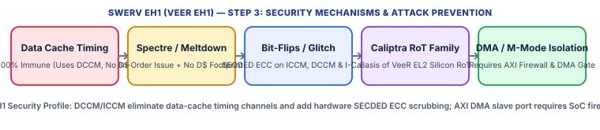

VeeR EH1's memory architecture—combining an in-order pipeline, `ICCM`/`DCCM` scratchpads with full SECDED ECC scrubbing, and `MRAC` side-effect gating—eliminates data-cache side channels and hardens against bit-flip glitches, forming the direct architectural foundation for **VeeR EL2** in the **Caliptra** Root-of-Trust.

| Attack / Threat Vector | Core / SoC Mechanism Used | How It Prevents or Mitigates the Attack |
| :--- | :--- | :--- |
| **Data Cache-Timing Attacks (`Flush+Reload`, `Prime+Probe`, `Evict+Time`)** | Zero L1 Data Cache (All Fast Data Lives in 8-Bank `DCCM`) | 100% Immune on Data Path — `DCCM` is directly addressed SRAM with zero tag eviction; placing S-Boxes and keys in `DCCM` & code in `ICCM` completely eliminates cache-timing leaks. |
| **Spectre v1 / v4 & Meltdown (Data Cache Transient Leaks)** | In-Order Issue + Zero Data Cache + `MRAC` Side-Effect Load Gating | Immune to D$ Transient Footprint — Even if a branch resolves late in `EX3`, wrong-path loads targeting `DCCM` cannot evict cache lines, and loads to `MRAC` side-effect regions stall until non-speculative. |
| **Bit-Flip Fault Injection & Cosmic-Ray Soft Errors** | 39-Bit SECDED ECC on `ICCM`, `DCCM` (with Auto-Scrubbing) & `I-Cache` | Single-bit faults in `ICCM`/`DCCM` are corrected on the fly and scrubbed back to SRAM; `I-Cache` errors auto-invalidate and re-fetch; double-bit faults trigger precise NMI (`mdccmeectr`/`miccmeectr`). |
| **Instruction Timing Side Channels** | Fixed 1-Cycle ALUs (`EX1`/`EX3`) & Fixed 3-Cycle Pipelined Multiplier | Arithmetic, logic, bit-manipulation (`Zba`/`Zbb`/`Zbs`), and 32-bit multiplications (`MUL`/`MULH`) execute in fixed, operand-independent cycle counts (only out-of-pipe `DIV` is variable-latency). |
| **Privilege Escalation & Unauthorized DMA Access** | `M-Mode` Only in EH1 + External AXI4 Slave DMA Port into `ICCM`/`DCCM` | EH1 lacks internal `U-mode`/`PMP` (added in sibling `VeeR EL2` / Caliptra); SoC must place an AXI firewall on the `LSU` master and strictly gate the `DMA` slave port. |

#### 3.1 Complete Elimination of Data-Cache Timing Attacks (`Prime+Probe` & `Flush+Reload`) via `DCCM` & `ICCM`

In processors with an L1 Data Cache, table-based cryptography (such as AES T-tables) or secret-indexed array lookups leave a cache-line footprint that an attacker can measure via `Prime+Probe` or `Flush+Reload`. VeeR EH1 has **no L1 Data Cache**. When security-critical data and stacks are placed in the **DCCM** and security-critical code is placed in the **ICCM**, every single instruction fetch and data load/store hits deterministic, non-evictable on-chip SRAM with **zero cache tags and zero miss penalty**.

#### 3.2 Protection Against Speculative Execution (`Spectre` / `Meltdown`)

First, EH1 executes in Machine Mode without virtual memory page tables, so user-to-kernel `Meltdown` does not exist. Second, although EH1 can issue a load in `DC1` before a load-dependent branch resolves in `EX3` (a 2-cycle window), any load targeting **DCCM** merely reads a deterministic SRAM bank without changing any cache replacement state! Furthermore, for external AXI memory or memory-mapped security peripherals, configuring the **MRAC (`0x7c0`)** CSR to mark those 256 MiB regions as **Side-Effect (`SE = 1`)** forces the `LSU` to stall any external load in `DC1` until all older branches in the pipeline have resolved and the load is guaranteed to be non-speculative!

#### 3.3 Hardware Fault-Injection & Glitch Resilience via Auto-Scrubbing SECDED ECC

VeeR EH1 was designed for enterprise storage environments where silent data corruption is unacceptable, which also makes it resilient against single-bit laser/EM fault injection on SRAM arrays:
1. **DCCM Auto-Scrubbing**: Every 32-bit word in `DCCM` has 7 Hsiao SECDED ECC bits. If a glitch flips 1 bit in `DCCM`, a load reading that word in `DC2` corrects the value before forwarding it to `DC3`/`EX3` *and* automatically queues a scrubbing writeback in `DC4` to overwrite the corrupted SRAM cell with the healed 39-bit codeword.
2. **ICCM & I-Cache Recovery**: Single-bit errors in `ICCM` are corrected inline; parity/ECC errors in the `I-Cache` automatically invalidate the cache line and re-fetch from external memory.
3. **Hardware Error Threshold Counters (`miccmeectr` / `mdccmeectr`)**: Count single-bit corrections and trigger a fast Non-Maskable Interrupt (`NMI`) as soon as a programmable threshold (or any 2-bit uncorrectable fault) is reached, allowing firmware to zeroize keys immediately.

#### 3.4 Securing the AXI4 DMA Slave Port & Evolution to `VeeR EL2` (Caliptra Root-of-Trust)

Because VeeR EH1 is `M-mode` only and exposes a high-speed **AXI4 Slave DMA Port** directly into its internal `ICCM` and `DCCM` SRAM banks, an untrusted bus master on the SoC could read secrets out of `DCCM` or overwrite code in `ICCM` if the DMA port is left open! Therefore, SoC integrators must place a hardware **AXI Firewall / MPU** in front of the `DMA` slave port (restricting it to a trusted boot ROM DMA engine) and lock the JTAG/AXI Debug System Bus (`SB`). In Microsoft/Google/AMD/NVIDIA's open **Caliptra Silicon Root-of-Trust**, EH1's compact 4-stage sibling **VeeR EL2** adds hardware **Physical Memory Protection (`PMP` / `Smepmp`)**, `User Mode`, and constant-time execution controls inside a dedicated hardware cryptographic vault.

## Core 8: [SpinalHDL VexRiscv](https://github.com/SpinalHDL/VexRiscv)

* **Official Documentation**: [https://github.com/SpinalHDL/VexRiscv](https://github.com/SpinalHDL/VexRiscv)
* **Source Repository**: [https://github.com/SpinalHDL/VexRiscv](https://github.com/SpinalHDL/VexRiscv)

### Step 1: About the Core (How to Explain VexRiscv to Someone)

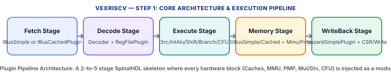

VexRiscv, created by Charles Papon in **SpinalHDL** (a Scala-based hardware description language) and serving as the default CPU in the **LiteX** FPGA SoC ecosystem, is one of the most widely deployed 32-bit RISC-V (`RV32IMAFDC`) processors in the world. To explain VexRiscv to someone, use the **'Empty Skeleton + Lego Plugins'** mental model: in almost every other CPU, the pipeline stages are hardcoded in Verilog and you can only toggle a few `ifdef` parameters. In VexRiscv, the core is literally an empty container of 2 to 5 pipeline stages (`Fetch`, `Decode`, `Execute`, `Memory` [optional], `WriteBack` [optional]), and **100% of the processor's functionality—even the program counter, register file, ALU, hazard unit, caches, MMU, PMP, and custom instructions—is injected at compile time by Scala `Plugin` classes**! By swapping plugins, the exact same codebase generates anything from a 350-LUT bare-metal controller (`VexRiscv_Smallest`) to a 350 MHz dual-cache, `Sv32` MMU-equipped processor booting Debian Linux (`VexRiscv_Linux`).

| Architectural Property | Specification & Design Choice |
| :--- | :--- |
| **Base ISA & Extensions** | `RV32I` / `RV32E`, plus modular plugins for `M` (Mul/Div), `A` (Atomics: LR/SC & AMO), `F`/`D` (`FpuPlugin`), `C` (Compressed), `Zicsr`, `Zifencei`, and custom `CFU` instructions |
| **Pipeline Depth** | Configurable **2 to 5 in-order stages**: `Fetch -> Decode -> Execute -> [Memory] -> [WriteBack]` |
| **Core Design Pattern** | **SpinalHDL Stageable & Plugin Architecture**: plugins declare signals (`Stageable`) and inject combinatorial/sequential hardware into any stage |
| **Privilege & Isolation Plugins** | `CsrPlugin` (configurable from `M-mode` only up to full `M`/`S`/`U` Linux privilege levels), `MmuPlugin` (`Sv32`), and `PmpPlugin` (Physical Memory Protection) |
| **Accelerator Interface** | `CfuPlugin` (**Custom Function Unit**) for tightly coupling custom RISC-V instructions (e.g., AES, SHA, or ML dot-product accelerators) directly into the Execute stage |
| **Supported Bus Fabrics** | Native VexRiscv bus with built-in SpinalHDL bridges to **AXI4**, **AXI4-Lite**, **Wishbone**, **Avalon**, and **AHB-Lite** |

#### Step-by-Step Pipeline & Execution Walkthrough

* **1. Compile-Time Hardware Generation (`SpinalHDL` Elaboration)**: When you run `sbt`, Scala instantiates a `VexRiscvConfig` containing a list of plugins (e.g., `IBusCachedPlugin`, `DecoderSimplePlugin`, `RegFilePlugin`, `IntAluPlugin`, `SrcPlugin`, `FullBarrelShifterPlugin`, `HazardSimplePlugin`, `BranchPlugin`, `DBusCachedPlugin`, `MmuPlugin`, `CsrPlugin`). Each plugin hooks into the pipeline stages, automatically synthesizing the exact inter-stage pipeline registers and hazard/flush wires needed—and nothing else—emitting a single clean `VexRiscv.v` Verilog file.
* **2. Stage 1 & 2 — Fetch (`F`) & Decode (`D`)**: `IBusSimplePlugin` (uncached) or `IBusCachedPlugin` (L1 I-Cache) fetches instructions and handles optional `RVC` decompression and branch prediction (`NONE`, `STATIC`, `DYNAMIC`, or `DYNAMIC_TARGET` with a BTB/BHT). In `Decode`, `DecoderSimplePlugin` decodes opcodes and `RegFilePlugin` reads `rs1` and `rs2`.
* **3. Stage 3 — Execute (`E`)**: `SrcPlugin` selects ALU operands, `IntAluPlugin` computes arithmetic/logic, `FullBarrelShifterPlugin` (or `LightShifterPlugin`) performs shifts, `BranchPlugin` evaluates branches (either in `Execute` or one stage later in `Memory` for higher Fmax), and `CfuPlugin` / `FpuPlugin` run custom or floating-point operations.
* **4. Stage 4 & 5 — Memory (`M`) & WriteBack (`W`)**: `DBusSimplePlugin` or `DBusCachedPlugin` translates addresses through `MmuPlugin` / `PmpPlugin` and accesses data memory or L1 Data Cache. `HazardSimplePlugin` manages `E -> E`, `M -> E`, and `W -> E` bypass forwarding (or stalls `Decode` when bypass paths are disabled for tiny area), and `WriteBack` commits results to the register file.

### Step 2: Every Memory Section Used in VexRiscv

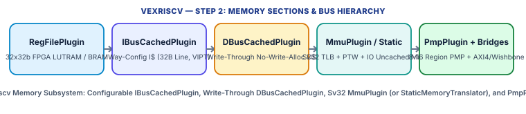

In VexRiscv, every memory section is controlled by a specific SpinalHDL plugin, giving designers fine-grained control over cache geometry, write-through policies, virtual memory translation, and uncached MMIO regions.

#### 2.1 Register File (`RegFilePlugin`)

* Storage Architecture: Maps the 32 x 32-bit integer register file (`x0`–`x31`) into synchronous FPGA Dual-Port Distributed RAM (LUTRAM) or Block RAM (`SYNC` read in `Decode`) or asynchronous registers (`ASYNC`).
* Write-to-Read Forwarding & Hardwiring: `x0` can be hardwired to zero or stored in RAM cell 0; `HazardSimplePlugin` provides configurable bypass multiplexers from `Execute`, `Memory`, and `WriteBack` back into `Decode`/`Execute`. No hardware ECC is included by default.

#### 2.2 Instruction Memory Path (`IBusSimplePlugin` vs. `IBusCachedPlugin`)

* Uncached Option (`IBusSimplePlugin`): Issues direct 32-bit read bursts/words over the instruction bus with a small stream FIFO (1–7 entries) and configurable response latency. Zero cache tags or lines.
* Cached Option (`IBusCachedPlugin` — L1 Instruction Cache): Parameterizable total size (`cacheSize`, e.g., **4 KiB to 32 KiB**), associativity (`wayCount = 1, 2, or 4 ways`), and cache line size (`bytePerLine = 32 bytes` by default). For a **4 KiB, 1-way (direct-mapped), 32-byte line** I-Cache ($S = 128	ext{ sets}$): `Offset = 5 bits` (`addr[4:0]`), `Index = 7 bits` (`addr[11:5]`), and `Tag = 20 bits` (`addr[31:12]`). All 12 index+offset bits fit within the 4 KiB page offset, allowing **VIPT** lookup in parallel with the ITLB!

#### 2.3 Data Memory Path (`DBusSimplePlugin` vs. `DBusCachedPlugin`)

* Uncached Option (`DBusSimplePlugin`): Issues direct word/halfword/byte reads and writes over the data bus (`dBus`), optionally catching misaligned addresses.
* Cached Option (`DBusCachedPlugin` — L1 Data Cache): Parameterizable size (**4 KiB to 32 KiB**), ways (`1, 2, or 4 ways`), and line size (**32 or 64 bytes**). Crucially, VexRiscv's L1 Data Cache uses a **Write-Through, No-Write-Allocate** policy! Every store (`SW`, `SH`, `SB`) updates the matching L1D cache line (if present) **and immediately writes through to the external memory bus**, while a store miss writes directly to external memory without allocating a cache line.
* Atomic Operations (`RV32A`): Supports `LR.W` / `SC.W` (via a hardware reservation register) and `AMO*` instructions in the Linux/Full configurations.

#### 2.4 Virtual Memory (`MmuPlugin`), Static Translation & Physical Memory Protection (`PmpPlugin`)

* `MmuPlugin` (Linux `Sv32` MMU & TLB): Implements full 2-level **RISC-V Sv32** virtual-to-physical page translation (4 KiB pages and 4 MiB megapages) with a configurable fully-associative TLB (typically 4 to 8 entries per port) and a hardware Page Table Walker (`PTW`) sharing the `dBus` read channel.
* Hardware Cacheability Map (`ioRange` Function): Both `MmuPlugin` and `StaticMemoryTranslatorPlugin` take a Scala lambda function `ioRange: UInt => Bool` (e.g., `addr(31 downto 28) === 0xF`) that marks specific physical address ranges as **Uncacheable MMIO**. Any load/store to an `ioRange` address automatically bypasses `DBusCachedPlugin`!
* `PmpPlugin` (Hardware Physical Memory Protection): Implements up to **16 RISC-V PMP regions** (`TOR`, `NA4`, `NAPOT` with `R/W/X/L` bits) checked in hardware against physical addresses.

#### 2.5 Coherence, Multi-Core Support (`VexRiscvSmpCluster`) & Memory Ordering

* Single-Core vs. SMP Coherence: Standard single-core VexRiscv uses its Write-Through L1D + software cache flush instructions (`0x500F` custom data-cache invalidate or `FENCE.I`). In multi-core LiteX setups (`VexRiscvSmpCluster`), multiple VexRiscv cores share a hardware cache-invalidation interconnect that broadcasts write-through invalidations across peer L1D caches.
* Memory Ordering: Strictly in-order pipeline; `FENCE` drains any pending bus write and `FENCE.I` invalidates the L1 Instruction Cache.

### Step 3: Security Mechanisms & How VexRiscv Prevents Attacks

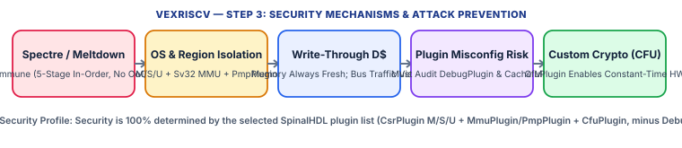

In VexRiscv, **your SpinalHDL plugin list is your hardware security architecture**. Because every feature is opt-in, a designer can build a heavily isolated `M/S/U + Sv32 MMU + PMP + Custom Crypto CFU` processor—or accidentally build an unisolated core if security plugins are omitted.

| Attack / Threat Vector | Core / SoC Mechanism Used | How It Prevents or Mitigates the Attack |
| :--- | :--- | :--- |
| **Spectre v1 / v2 / v4 & Meltdown (Transient Execution)** | 5-Stage In-Order Pipeline + Synchronous `MmuPlugin`/`PmpPlugin` Faulting | 100% Immune to Out-of-Order Transient Attacks — Branches resolve in `Execute` (or `Memory`) before younger instructions can speculatively load into `DBusCachedPlugin`; `MmuPlugin` blocks unauthorized kernel data before `WriteBack`. |
| **Privilege Escalation & Unauthorized Memory Access** | `CsrPlugin` (`M/S/U`) + `MmuPlugin` (`Sv32`) + `PmpPlugin` + `ioRange` | Full page-granular (`Sv32`) and physical region (`PMP`) `R/W/X` enforcement when configured; `Minimal` builds without `PmpPlugin`/`MmuPlugin` have zero internal isolation. |
| **Timing Side-Channel Attacks (Variable-Latency Shift/Mul/Div)** | `FullBarrelShifterPlugin` + `MulPlugin` vs. `LightShifterPlugin` / `MulSimplePlugin` | `LightShifterPlugin` (1 bit/cycle) leaks shift amounts via timing! Security builds must select `FullBarrelShifterPlugin` (constant 1-cycle shift) and use `CfuPlugin` for constant-time crypto. |
| **Cache-Timing Attacks (`Flush+Reload`, `Prime+Probe`)** | Write-Through `DBusCachedPlugin` vs. `DBusSimplePlugin` / `ioRange` | When caches are enabled, local L1 sets can be probed across context switches; sensitive key RAM can be mapped into `ioRange` (forcing uncached access) or flushed via cache-invalidation CSRs/instructions. |
| **JTAG / Debug Backdoor Attacks** | `DebugPlugin` (External Debug Bus Allowing Arbitrary Register/Memory Read/Write) | Leaving `DebugPlugin` instantiated and un-gated in production bitstream/silicon allows an attacker on the debug bus to halt the CPU and dump all memory—remove or hardware-lock `DebugPlugin` for release! |
| **Physical Side-Channel (`SPA`/`DPA`) & Glitching** | No Default ECC/Lockstep; Custom Hardening via `CfuPlugin` & SpinalHDL Plugins | Base plugins lack ECC/lockstep, but SpinalHDL's plugin API allows inserting custom masked crypto engines via `CfuPlugin` or dual-core lockstep wrappers. |

#### 3.1 Why VexRiscv Is Immune to Spectre & Meltdown

VexRiscv is a strictly in-order single-issue pipeline (`F -> D -> E -> M -> W`) with no Reorder Buffer, no register renaming, and no out-of-order load/store queues. When `BranchPlugin` is configured with `earlyBranch = true`, branches resolve in `Execute` (`E`) *before* any younger wrong-path instruction reaches the `Memory` (`M`) stage where `DBusCachedPlugin` is accessed—so wrong-path loads never touch the L1 Data Cache (`Spectre v1` immunity). Furthermore, in the `Memory` stage, `MmuPlugin` (`Sv32`) and `PmpPlugin` check privilege and `R/W/X` permissions synchronously; any violation raises an immediate exception (`trap`) and cancels the register writeback in `W`, preventing `Meltdown`.

#### 3.2 How Plugin Choices Create or Close Timing Side Channels (`LightShifter` vs. `FullBarrelShifter` & `CFU`)

A major strength—and pitfall—of VexRiscv is that two configurations running the exact same binary can have completely different timing side-channel behavior:
1. **Shifter Timing Leak**: If a designer builds VexRiscv with `LightShifterPlugin` to save ~100 LUTs, the core executes `SLL rd, rs1, rs2` by stalling the `Execute` stage for `rs2[4:0]` clock cycles (0 to 31 cycles). If `rs2` holds secret data, the execution time directly leaks `rs2`! Switching to **`FullBarrelShifterPlugin`** performs all 0–31 bit shifts in a constant 1 cycle.
2. **Custom Function Unit (`CfuPlugin`) for Constant-Time Crypto**: Instead of running table-based AES in software (which leaks via cache timing), VexRiscv provides a standardized **`CfuPlugin`** bus directly inside the `Execute` stage (`custom-0` opcode space), allowing designers to attach a constant-time, masked hardware AES/SHA/Ascon accelerator with 1-cycle register-to-register latency.

#### 3.3 Securing the Cache Hierarchy (`Write-Through D$` and the `ioRange` Uncacheable Map)

Because `DBusCachedPlugin` is a **Write-Through, No-Write-Allocate** L1 Data Cache:
1. **Store Visibility on the Bus**: Every store immediately generates a bus write transaction on `dBus` (even on a cache hit). While this keeps main memory always up to date, an attacker monitoring external bus traffic can observe store addresses unless secret scratchpad RAM is isolated on a local private bus.
2. **Bypassing the Data Cache for Secret Keys (`ioRange`)**: By including a dedicated Secure Key Scratchpad address range inside VexRiscv's `ioRange` lambda parameter, `DBusCachedPlugin` treats that scratchpad as uncacheable—ensuring secret keys and S-Boxes are **never** stored in L1D cache lines where a subsequent untrusted process could mount a `Prime+Probe` or `Flush+Reload` attack.

#### 3.4 The Production Checklist: Auditing the SpinalHDL Plugin List (`DebugPlugin`, `PmpPlugin`, `MmuPlugin`)

Before deploying a VexRiscv bitstream (for example in a LiteX SoC), security engineers must audit the Scala `VexRiscvConfig` plugin list: (1) Ensure `CsrPlugin` enables `User` mode (`U-mode`) alongside `MmuPlugin` (`Sv32`) or `PmpPlugin` so application code cannot run with unrestricted `M-mode` privileges; and (2) **Remove or hardware-gate `DebugPlugin`**, because `DebugPlugin` exposes a slave bus interface that can halt the pipeline, read/write any register, and inject arbitrary instructions without checking `PMP` or `MMU` permissions.

## Core 9: [UC Berkeley SonicBOOM (BOOMv3)](https://docs.boom-core.org/en/latest/)

* **Official Documentation**: [https://docs.boom-core.org/en/latest/](https://docs.boom-core.org/en/latest/)
* **Source Repository**: [https://github.com/riscv-boom/riscv-boom](https://github.com/riscv-boom/riscv-boom)

### Step 1: About the Core (How to Explain SonicBOOM (BOOMv3) to Someone)

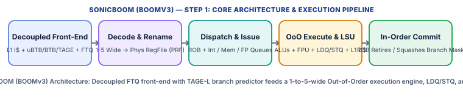

SonicBOOM (**BOOMv3**), developed at the UC Berkeley Architecture Research (`UCB-BAR`) group by Jerry Zhao, Christopher Celio, Krste Asanović, and colleagues, is the third-generation **Berkeley Out-of-Order Machine**—a synthesizable, parameterizable, **superscalar Out-of-Order 64-bit RISC-V (`RV64GC`)** processor written in Chisel and integrated into **Chipyard** and **FireSim**. When explaining SonicBOOM to someone, describe it as **the open-source equivalent of a modern commercial laptop/desktop CPU core**: unlike in-order cores (Rocket, CVA6, Ibex) that stall whenever an instruction waits for memory, SonicBOOM decouples instruction fetching from execution using a **Fetch Target Queue (`FTQ`)** and a state-of-the-art **TAGE-L branch predictor**, renames architectural registers onto large **Physical Register Files (`PRF`)** to erase false hazards, and keeps up to **128 instructions in flight in its Reorder Buffer (`ROB`)** so younger independent instructions execute out of order while older cache misses are still in flight!

| Architectural Property | Specification & Design Choice |
| :--- | :--- |
| **Base ISA & Privilege** | `RV64GC` (`RV64IMAFDC`), `Zicsr`, `Zifencei`, with full Machine (`M`), Supervisor (`S`), and User (`U`) modes + **Sv39** virtual memory |
| **Superscalar Configurations** | Parameterizable from 1-wide (`SmallBoomConfig`) to 2-wide (`Medium`), 3-wide (`Large`), 4-wide (`MegaBoomConfig`), and 5-wide (`GigaBoomConfig`) |
| **Front-End & Branch Predictor** | Decoupled 4-stage Front-End with Next-Line Predictor (`NLP` / $\mu	ext{BTB}$), `BTB`, **TAGE-L** conditional predictor, Loop Predictor, `RAS`, and **Fetch Target Queue (`FTQ`)** |
| **Out-of-Order Window (`MegaBOOM`)** | **128-entry Reorder Buffer (`ROB`)**, **128 Physical Integer Registers**, **128 Physical FP Registers**, 32-entry Load Queue (`LDQ`), 32-entry Store Queue (`STQ`) |
| **Issue Queues & Execution Units** | Split **Integer Issue Queue** (40 entries), **Memory Issue Queue** (24 entries), and **FP Issue Queue** (32 entries) feeding 4 ALUs, 2 AGUs, and 2 FPU pipes |
| **Branch Speculation Tracking** | **Branch Mask (`br_mask`)** bitvector attached to every in-flight micro-op (`uop`) for single-cycle wrong-path squashing without stalling the ROB |

#### Step-by-Step Pipeline & Execution Walkthrough

* **1. Decoupled Front-End (`F0 -> F1 -> F2 -> F3` & `FTQ`)**: SonicBOOM fetches an entire **Fetch Packet** (4 or 8 instructions, up to 16 bytes) per cycle from the L1 I-Cache. A single-cycle $\mu	ext{BTB}$ (`F0`) predicts the next fetch packet immediately, while the large **TAGE-L** predictor (`F1–F3`) verifies the prediction and pushes predicted control-flow blocks into the **Fetch Target Queue (`FTQ`)** (`32 entries`). Holding PCs in the `FTQ` saves massive area because individual instructions in the ROB don't have to carry their own 64-bit `PC`!
* **2. Decode, Register Rename & Dispatch (`Decode -> Rename1 -> Rename2/Dispatch`)**: Instructions from the Fetch Buffer are decoded into micro-ops (`uops`). In **Rename**, architectural register specifiers (`x1`–`x31`, `f0`–`f31`) are mapped via the **Rename Map Table** and **Free List** onto 128 physical registers—completely eliminating Write-After-Read (`WAR`) and Write-After-Write (`WAW`) hazards! Each `uop` is also tagged with a **Branch Mask** (one bit per unresolved branch) and dispatched in program order into the **ROB** (`128 entries`), one of the **3 Issue Queues** (`Int`, `Mem`, `FP`), and the **LDQ/STQ** (if it is a load or store).
* **3. Out-of-Order Issue, Register Read & Execution (`Issue -> RegRead -> Execute`)**: As soon as a `uop`'s source physical registers are marked ready in the **Busy Table**, the Issue Queue wakes it up—**out of program order**—reads its operands from the Physical Register File (`PRF`) or bypass network, and executes it on an ALU, Multiplier, FPU, or Address Generation Unit (`AGU`). When a branch resolves in an ALU: if correct, its bit is cleared across all in-flight Branch Masks; if **mispredicted**, every `uop` across the Issue Queues and LSU whose Branch Mask has that bit set is **squashed in a single cycle** and the Rename Map Table rolls back to the branch's snapshot!
* **4. Load/Store Execution (`M0 -> M1 -> M2`) & In-Order ROB Commit (`Commit`)**: Loads and stores compute virtual addresses in `AGU` and access the `DTLB`, `LDQ`/`STQ`, and banked non-blocking L1 Data Cache. Finally, when instructions reach the head of the **ROB** with no exceptions, the ROB **commits them in strict program order**—freeing old physical registers and releasing committed stores in the `STQ` to write into the L1 Data Cache.

### Step 2: Every Memory Section Used in SonicBOOM (BOOMv3)

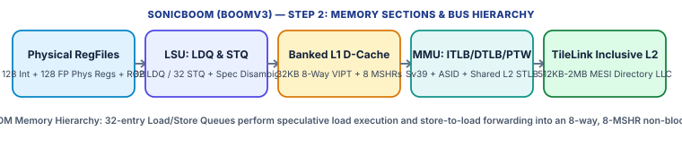

SonicBOOM's memory subsystem was completely redesigned in BOOMv3 around a high-throughput Load/Store Unit (`LSU`), dual-ported/banked non-blocking L1 Data Cache, multi-level TLBs, and a coherent TileLink L2 hierarchy.

#### 2.1 Physical Register Files (`PRF`), Rename Map Tables & Reorder Buffer (`ROB`)

* Split Integer & Floating-Point Physical Register Files: In the 4-wide `MegaBOOM` config, SonicBOOM implements a **128-entry x 64-bit Physical Integer Register File** (up to 8 read ports, 4 write ports) and a **128-entry x 65-bit Physical Floating-Point Register File** (using IEEE-754 recoded 65-bit format).
* Rename Map Table + Committed Map Table + Branch Snapshots: Tracks the current speculative mapping (`Arch Reg -> Phys Reg`), the architectural committed mapping (for exception recovery), and per-branch shadow snapshots (for single-cycle branch misprediction recovery).
* 128-Entry Reorder Buffer (`ROB`): Organized as a circular buffer of 32 rows x 4 columns (matching the 4-wide dispatch/commit width) tracking completion status and precise exception codes.

#### 2.2 Load/Store Unit (`LSU`): Load Queue (`LDQ`) & Store Queue (`STQ`)

* 32-Entry Load Queue (`LDQ`) & 32-Entry Store Queue (`STQ`): Allocated in program order during Dispatch (`dis_ldq_idx`, `dis_stq_idx`) so every load knows exactly which stores in the `STQ` are older than it.
* Speculative Out-of-Order Load Execution & Memory Disambiguation: A younger load in the `LDQ` is allowed to issue to the L1 Data Cache **speculatively before older stores in the `STQ` have even calculated their memory addresses**! When an older store later computes its address in `AGU`, it CAM-searches the `LDQ` for any younger load that already executed from the same address: if a match is found, an **Ordering Failure (Mini-Exception)** is flagged in the ROB, squashing and replaying the offending load and all younger instructions.
* Store-to-Load Forwarding: When a load executes (`M0–M2`), it simultaneously searches the `STQ` for any older uncommitted store to the same physical address. If the older store's address and data are both present in the `STQ`, the `STQ` forwards the data directly to the load in `M2`; if the older store's address matches but its data is not yet ready, the load is put to sleep and replayed later.
* Committed Store Drain: Speculative stores in the `STQ` **never** modify the L1 Data Cache! Only after a store retires from the head of the ROB is its `STQ` entry marked `committed` and drained into the L1D SRAM during idle cache bank cycles.

#### 2.3 L1 Instruction Cache (L1I) & Banked Non-Blocking L1 Data Cache (L1D)

* L1 Instruction Cache (L1I): **32 KiB**, **8-way set-associative**, **64-byte cache lines**, **VIPT** (6 index bits `addr[11:6]`, 6 offset bits `addr[5:0]`, zero aliasing on 4 KiB pages). Fetches aligned 16-byte or 32-byte fetch packets per cycle.
* Banked Non-Blocking L1 Data Cache (`BoomNonBlockingDCache`): **32 KiB**, **8-way set-associative**, **64-byte cache lines**, **VIPT**, **Write-Back, Write-Allocate**. Divided into **8 SRAM banks** (interleaved by doubleword `addr[5:3]`) so SonicBOOM can service **2 simultaneous load accesses (or 1 load + 1 store drain) per clock cycle** as long as they hit different doubleword banks!
* 8 Non-Blocking MSHRs (`Miss Status Holding Registers`) + Line Fill / Writeback Buffers (`LFB` / `WBQ`): Tracks up to **8 concurrent cache-line misses** (with multiple loads coalescing onto each MSHR) and includes an optional **Next-Line / Stride Hardware Prefetcher**.

#### 2.4 Virtual Memory: L1 ITLB, Dual-Ported L1 DTLB, Shared L2 STLB & `PTW`

* L1 ITLB & Dual-Ported L1 DTLB: 32-entry fully-associative L1 ITLB and a **dual-ported 32-entry fully-associative L1 DTLB** (translating 2 virtual addresses per cycle in Stage `M0` in parallel with L1D VIPT SRAM indexing!).
* Shared L2 TLB (`STLB`) & Hardware Page Table Walker (`PTW`): A **512- to 1,024-entry L2 Shared TLB** backs the L1 TLBs, serviced on misses by the **Sv39** (3-level, 39-bit VA) Hardware Page Table Walker (`PTW`), with `ASID` tagging and 8–16 physical `PMP` regions.

#### 2.5 Shared Inclusive L2 Cache, `TileLink` MESI Coherence & `RVWMO` Consistency

* TileLink Coherent (`TL-C`) Uncore & Shared L2: SonicBOOM's L1D and L1I connect over coherent **TileLink** to Chipyard's **512 KiB – 2 MiB Banked Inclusive L2 Cache**, which maintains a full **MESI directory**. When another core writes to a shared cache line, the L2 directory sends a TileLink `Probe` to SonicBOOM's L1D; SonicBOOM's L1D invalidates the line *and* snoops the `LDQ` to squash any in-flight speculative load that read the invalidated line before commit!
* RVWMO Consistency: SonicBOOM aggressively exploits **RVWMO** weak ordering by issuing loads out of order and buffering stores in the `STQ`; software enforces ordering across cores using `FENCE r,r`, `FENCE rw,rw`, or `.aq`/`.rl` atomics.

### Step 3: Security Mechanisms & How SonicBOOM (BOOMv3) Prevents Attacks

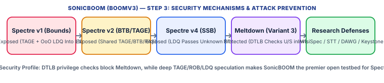

SonicBOOM is the world's premier open-source microarchitectural security research core precisely because it implements **every aggressive performance optimization—TAGE branch prediction, out-of-order speculative load execution, speculative store bypassing, and shared non-blocking caches—that creates Spectre-class transient execution channels in commercial CPUs**.

| Attack / Threat Vector | Core / SoC Mechanism Used | How It Prevents or Mitigates the Attack |
| :--- | :--- | :--- |
| **Spectre v1 (Bounds-Check Bypass)** | TAGE-L Predictor + Out-of-Order `LDQ` Issuing into Non-Blocking 8-MSHR L1D | Exposed in Baseline RTL — Wrong-path loads bring secret-indexed lines into the 32 KiB L1D and 2 MiB L2; ROB squash restores registers/RAT, but **cached lines remain in L1D/L2**! |
| **Spectre v2 (Branch Target Injection) & RSB Leaks** | Shared $\mu	ext{BTB}$, `BTB`, `TAGE-L` Tables, and 32-Entry `RAS` | Exposed in Baseline RTL — Predictor tables are indexed by virtual PC/history without privilege or ASID tags unless flushed or partitioned on context switches. |
| **Spectre v4 (Speculative Store Bypass)** | Speculative Memory Disambiguation (`LDQ` Issues Before Older `STQ` Addresses Resolve) | Exposed in Baseline RTL — A younger load can speculatively read stale data from L1D before an older aliasing store in the `STQ` overwrites it, leaking stale secret data into the cache before the ROB ordering flush. |
| **Meltdown (Variant 3 — Rogue Data Cache Load)** | Synchronous `DTLB` + `PMP` Privilege Check in Stage `M1` Before Data Forwarding in `M2` | **Protected in Hardware** — In SonicBOOM's LSU (`lsu.scala`), `DTLB` page-fault and `PMP` access-fault signals are evaluated in `M1` and gate data writeback/forwarding in `M2`, preventing user-mode loads from transiently reading `S-mode` kernel memory! |
| **Cache-Timing Attacks (`Flush+Reload`, `Prime+Probe`, `Evict+Time`)** | Shared 32 KiB L1D (Same-Core) & Shared 512KB–2MB Inclusive L2 (Cross-Core) | Vulnerable without Partitioning — Mitigated in Chipyard using **DAWG (Way-Partitioned L2)**, **Keystone / Sanctum** page coloring, and L1/TLB flushing on enclave switches. |
| **Architectural Memory Isolation** | `M/S/U` Modes + `Sv39` Page Tables + 8–16 Region Hardware `PMP` | Enforces strict architectural process and kernel isolation; compatible with the **Keystone Enclave** security monitor. |

#### 3.1 Exact Hardware Walkthrough: Why SonicBOOM Is Vulnerable to Spectre v1, v2, and v4

In SonicBOOM, trace what happens when an attacker mistrains the **TAGE-L** predictor on a bounds check (`if (x < len) y = probe[secret[x] * 4096];`):
1. **Branch Mistraining**: In Stage `F1–F3`, TAGE-L predicts the branch taken (`x < len`), and the wrong-path instructions (`LD t0, secret[x]` and `LD t1, probe[t0 * 4096]`) are decoded, renamed into the 128-entry `PRF`, and dispatched into the **128-entry ROB** and **32-entry LDQ** with a `br_mask` bit set for the unresolved branch.
2. **Out-of-Order Speculative Load Execution**: Because `x` is already in a register (or arrives before `len`, which was evicted from cache via `clflush`/eviction set), the `Memory Issue Queue` wakes up `LD t0, secret[x]`. In Stage `M0–M2`, `t0` reads the secret byte from L1D and broadcasts `t0` onto the wakeup/bypass bus, which immediately wakes up the second load `LD t1, probe[t0 * 4096]`!
3. **The Persistent Cache Footprint**: `LD t1` misses in the 32 KiB L1D, allocates one of the **8 MSHRs**, and fetches cache line `probe[secret_val * 4096]` over TileLink into the L2 and L1D SRAM arrays.
4. **The Squash**: Cycles later, `len` returns from DRAM, the branch unit ALU detects the misprediction, and broadcasts `brupdate.b2.mispredict`. SonicBOOM clears every ROB, Issue Queue, and `LDQ` entry matching that `br_mask` bit and restores the Rename Map Table—so `t0` and `t1` vanish from architectural state. **However, the MSHR fill into the L1D/L2 SRAM is not undone!** The attacker then times `probe[0..255 * 4096]` via `Flush+Reload` or `Prime+Probe` to read `secret[x]`.

#### 3.2 Why SonicBOOM Is Protected Against Meltdown (`Variant 3`)

Unlike early commercial x86 cores that forwarded L1D data to dependent speculative uops *before* checking the Page Table Entry's User/Supervisor (`U`) bit, SonicBOOM performs the `DTLB` lookup in Stage `M0` and evaluates the Sv39 page permissions (`R/W/X/U`) and `PMP` rules in Stage `M1`. If a User-mode (`U-mode`) load targets a Supervisor (`S-mode`) kernel address, `dtlb.io.resp.pf.ld` (Load Page Fault) is asserted in `M1`, which **annuls the L1D data response and blocks the `M2` wakeup/writeback into the Physical Register File**. Thus, dependent instructions waiting in the Issue Queue never wake up and never receive the kernel data, stopping Meltdown in hardware.

#### 3.3 Hardware & Software Defenses Deployed on SonicBOOM (From `FENCE` to `InvisiSpec` & `STT`)

Because SonicBOOM's Chisel RTL is open, both software mitigations and hardware defensive architectures are implemented on it:
1. **Software Speculation Barriers (`FENCE rw,rw` & Index Masking)**: In SonicBOOM's LSU, a `FENCE` instruction stalls younger loads in the `LDQ` until all older instructions in the ROB and `STQ` have committed, acting as a speculation barrier against Spectre v1 and v4.
2. **Hardware Invisible Speculation (`InvisiSpec` / `CleanupSpec`)**: Adds a small speculative shadow buffer inside SonicBOOM's LSU so speculative loads read data without allocating lines in L1D/L2 or modifying LRU state until the ROB head reaches the load (when it becomes non-speculative).
3. **Speculative Taint Tracking (`STT` on SonicBOOM)**: Tags physical registers produced by speculative loads as *tainted* in the Rename Table and Issue Queues, allowing pure register compute to proceed speculatively at full speed while delaying only downstream instructions that would transmit the tainted value through a microarchitectural channel (such as a dependent load address).
4. **Predictor & Cache Isolation (`Keystone` + `DAWG`)**: Flushes the `BTB`, `TAGE-L`, `RAS`, `TLB` (`SFENCE.VMA`), and L1 caches (`FENCE.I`) on enclave/domain switches while partitioning the shared L2 ways (`DAWG`).

## Core 10: [UC Berkeley BOOM (v1 / v2 — Classic Berkeley Out-of-Order Machine)](https://docs.boom-core.org/en/latest/)

* **Official Documentation**: [https://docs.boom-core.org/en/latest/](https://docs.boom-core.org/en/latest/)
* **Source Repository**: [https://github.com/riscv-boom/riscv-boom](https://github.com/riscv-boom/riscv-boom)

### Step 1: About the Core (How to Explain BOOM (v1/v2) to Someone)

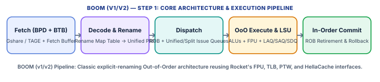

BOOM (**v1 and v2** of the Berkeley Out-of-Order Machine), created by Christopher Celio, David Patterson, and Krste Asanović at UC Berkeley, is the foundational open-source **superscalar Out-of-Order 64-bit RISC-V (`RV64G` / `RV64GC`)** processor written in Chisel. When explaining **BOOM (v1/v2)** to someone—and why it has its own dedicated study profile alongside **SonicBOOM (BOOMv3)**—highlight two key insights:
1. **The 'Drop-In Out-of-Order Rocket' Design**: BOOM v1/v2 was specifically engineered by replacing *only* the 5-stage in-order pipeline of **Rocket** with a textbook Out-of-Order execution engine (Fetch, Decode, Rename, Dispatch, Issue Queues, Physical Register File, Load/Store Queues, and Reorder Buffer) while **reusing Rocket's exact L1 Data Cache (`HellaCache`), FPU, TLBs, Page Table Walker (`PTW`), and TileLink uncore**! Because Rocket and BOOM v2 share the exact same caches and memory system, comparing Rocket vs. BOOM v2 isolates the exact performance and security impact of Out-of-Order execution with zero confounding variables.
2. **Clean Textbook Explicit Register Renaming (`BOOMv2`)**: BOOMv2 transitioned from a data-in-ROB design (`BOOMv1`) to the modern industry-standard **Unified Physical Register File (`PRF`)** model (like MIPS R10000 / Intel P6+: architectural registers are renamed via a Map Table and Free List into a large Physical Register File, while the ROB holds only instruction metadata).

| Architectural Property | Specification & Design Choice |
| :--- | :--- |
| **Base ISA & Extensions** | `RV64G` (`RV64IMAFD`) in v1/early v2, extended to `RV64GC` (with 16-bit Compressed `C`), `Zicsr`, `Zifencei` |
| **Pipeline Stages (10 Stages)** | `Fetch -> Decode -> Rename -> Dispatch -> Issue -> Register Read -> Execute -> Memory -> Writeback -> Commit (ROB)` |
| **Register Architecture** | `BOOMv1`: Data-in-ROB + Architectural RF; `BOOMv2`: Explicit **Rename Map Table + Free List + Unified Physical Register File (`PRF`)** |
| **Components Reused from Rocket** | Non-blocking L1 Data Cache (`HellaCache`), IEEE-754 FPU, `ITLB`/`DTLB`, `Sv39` Hardware Page Table Walker (`PTW`), `PMP`, and `TileLink` uncore |
| **Privilege & Virtual Memory** | Machine (`M`), Supervisor (`S`), and User (`U`) modes with **Sv39** 3-level virtual memory and **PMP** |
| **Key Evolution to SonicBOOM (v3)** | BOOMv2 used Rocket's single-ported `HellaCache` and coupled front-end; SonicBOOM (v3) replaced them with a decoupled `FTQ`, `TAGE-L`, and a custom 8-bank dual-load L1D |

#### Step-by-Step Pipeline & Execution Walkthrough

* **1. Instruction Fetch & Branch Prediction (`Fetch`)**: Fetches a bundle of instructions (e.g., 2 or 4 instructions per cycle) from the L1 Instruction Cache using a Two-Level Branch Predictor (`BTB` + Gshare/bimodal `BHT` + `RAS`) and places them into the Fetch Buffer.
* **2. Decode & Explicit Register Renaming (`Decode -> Rename`)**: Splits complex instructions into micro-ops (`uops`), allocates a new destination physical register (`pdst`) from the **Free List** for every instruction that writes a register, looks up the current physical registers (`pop1`, `pop2`, `pop3`) for source architectural registers in the **Rename Map Table**, and updates the Map Table to point to `pdst`. This removes all false name dependencies (`WAR` and `WAW` hazards).
* **3. Dispatch & Out-of-Order Wakeup/Select (`Dispatch -> Issue -> RegRead`)**: In `Dispatch`, each `uop` is allocated an entry in the **Reorder Buffer (`ROB`)**, a slot in the **Issue Queues** (Integer, Memory, or Floating-Point), and—for loads/stores—an entry in the **Load/Store Unit (`LAQ` / `SAQ` / `SDQ`)**. As soon as an execution unit broadcasts that a source physical register ID is ready, the Issue Queue's wakeup CAM marks matching operand slots ready, and the select arbiter issues the oldest ready `uop` to read the Physical Register File (`PRF`).
* **4. Execution, Memory Disambiguation & Precise In-Order Commit (`Execute -> Memory -> Commit`)**: Functional units (`ALU`, `MUL/DIV`, `FPU`, `AGU`) execute out of order. Memory operations access the `LSU` and Rocket's non-blocking `HellaCache`. Finally, the **ROB** retires completed `uops` **strictly in program order**—updating the **Committed Map Table**, returning overwritten physical registers to the Free List, releasing committed stores to write into `HellaCache`, or flushing the pipeline on a precise exception.

### Step 2: Every Memory Section Used in BOOM (v1/v2)

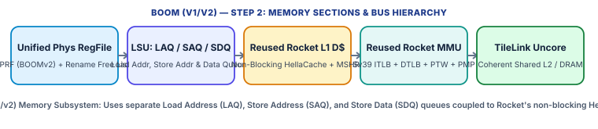

BOOM (v1/v2)'s memory subsystem is defined by its **three-queue Load/Store Unit (`LAQ`, `SAQ`, `SDQ`)** connected to Rocket's non-blocking **`HellaCache`** and **`Sv39` MMU**.

#### 2.1 Physical Register File (`PRF`), Free List & Reorder Buffer (`ROB`)

* BOOMv1 vs. BOOMv2 Storage Model: In `BOOMv1`, uncommitted speculative results lived inside the `ROB` and were copied to an Architectural Register File at commit. In `BOOMv2`, all both speculative and committed values live in a single **Unified Physical Register File (`PRF`)** (e.g., 80–128 physical 64-bit registers for 32 architectural registers). No data movement occurs at commit—the ROB simply updates the Committed Map Table and frees the previous physical register back to the **Free List**!

#### 2.2 The Three-Queue Load/Store Unit: `LAQ`, `SAQ`, and `SDQ`

* Split Store Address (`SAQ`) & Store Data (`SDQ`) Queues: Unlike in-order cores where a store's address and data arrive together, in an Out-of-Order core a store's base address register (`rs1`) is often ready many cycles before the value being stored (`rs2`, which might be waiting on a slow FP calculation!). BOOMv2 splits the Store Queue into a **Store Address Queue (`SAQ`)** and a **Store Data Queue (`SDQ`)** with independent issuewakeup slots so stores can calculate their address and check for memory ordering hazards as soon as `rs1` is ready!
* Load Address Queue (`LAQ`) & Speculative Memory Disambiguation: Loads are allocated in the **`LAQ`** at Dispatch. By default, BOOMv2 issues a load to `HellaCache` as soon as its address is ready, **speculatively assuming it does not conflict with any older store in the `SAQ` whose address is still unknown**. If an older store later writes an address into the `SAQ` that matches a younger already-executed load in the `LAQ`, the LSU signals an **Ordering Failure** to the ROB, flushing the pipeline after the store and setting a **Store-Wait bit** so the load waits on the next retry.
* Store-to-Load Forwarding (`SAQ`/`SDQ` -> `LAQ`): Every executing load CAM-searches the `SAQ` for older stores to the same physical address and forwards the newest matching data directly from the `SDQ` without waiting for the store to commit to `HellaCache`.

#### 2.3 Reused Rocket Caches (`L1 I$` & Non-Blocking `HellaCache` L1 D$)

* L1 Instruction Cache: **16 KiB or 32 KiB**, 4-way or 8-way set-associative, 64-byte lines, **VIPT**, widened to supply multi-instruction fetch bundles (2 or 4 instructions/cycle) to BOOM's front-end.
* L1 Data Cache (`HellaCache`): **16 KiB or 32 KiB**, 4-way or 8-way set-associative, 64-byte lines, **VIPT**, **Write-Back, Write-Allocate**, **Non-Blocking** with **2 to 8 MSHRs** (`Miss Status Holding Registers`). Because `HellaCache` is single-ported (1 load or 1 store-drain per cycle), BOOMv2 arbitrates between new speculative loads from the `LAQ` and committed store drains from the `SAQ`/`SDQ`.

#### 2.4 Virtual Memory (`Sv39` MMU, `ITLB`, `DTLB`, `PTW`) & `PMP`

* Direct Reuse of Rocket MMU: Uses Rocket's 32-entry fully-associative `ITLB` and `DTLB`, hardware **Sv39** 3-level Page Table Walker (`PTW`), `ASID` support, and 8–16 region hardware **Physical Memory Protection (`PMP`)** checkers.

#### 2.5 Shared L2 Cache, `TileLink` Coherence & `RVWMO` Ordering

* TileLink Coherent Uncore: Connects identically to a Rocket tile into the Chipyard **TileLink (`TL-C`)** fabric and shared inclusive L2 cache (MESI directory). Implements **RVWMO** weak memory ordering with `FENCE`, `FENCE.I`, and `SFENCE.VMA`.

### Step 3: Security Mechanisms & How BOOM (v1/v2) Prevents Attacks

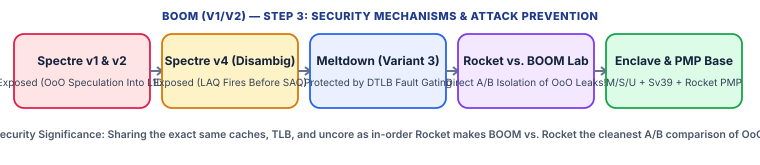

In computer architecture and hardware security education, **comparing Rocket vs. BOOM (v1/v2) is the single clearest demonstration of how Out-of-Order execution introduces transient execution vulnerabilities (`Spectre`)**. Because BOOM v2 and Rocket share the exact same `HellaCache`, `DTLB`, `PTW`, and `TileLink` L2 cache, every new vulnerability in BOOM v2 comes directly from its Out-of-Order pipeline (`Rename`, `ROB`, `LAQ`/`SAQ`, and `Branch Predictor`).

| Attack / Threat Vector | Core / SoC Mechanism Used | How It Prevents or Mitigates the Attack |
| :--- | :--- | :--- |
| **Spectre v1 (Bounds-Check Bypass)** | Out-of-Order `LAQ` Issues Speculative Loads Into `HellaCache` Past Unresolved Branches | Exposed (Unlike Rocket!) — While Rocket resolves branches in `EX` before `MEM`, BOOMv2 speculatively executes dozens of wrong-path loads in the `LAQ`, filling `HellaCache` lines that survive the ROB squash! |
| **Spectre v2 (Branch Target Injection)** | Shared `BTB` / `BHT` / `RAS` Across Privilege Modes & Processes | Exposed — An attacker can mistrain indirect branch targets or conditional history in the shared predictor to steer transient execution in victim code. |
| **Spectre v4 (Speculative Store Bypass)** | `LAQ` Executes Younger Loads Before Older `SAQ` Store Addresses Resolve | Exposed — A younger load can transiently bypass an older store to the same address, read a stale secret from `HellaCache`, and leak it into a dependent cache line before the `SAQ` CAM check triggers a replay. |
| **Meltdown (Variant 3 — Rogue Data Cache Load)** | Reused Rocket `DTLB` + `PMP` Permission Check Blocks Faulting Load Data | **Protected** — Because BOOMv2 reuses Rocket's `DTLB` and `HellaCache` fault path, a `U-mode` load targeting an `S-mode` kernel page raises a page fault before data is written into the `PRF`. |
| **Cache & TLB Side-Channel Attacks (`Prime+Probe`, `Flush+Reload`)** | Shared `HellaCache` L1D, `DTLB`, and Shared Inclusive TileLink L2 | Vulnerable without Isolation — Mitigated via `Keystone` / `Sanctum` L2 set/way partitioning, constant-time software, and context-switch cache/TLB flushing (`SFENCE.VMA`, `FENCE.I`). |
| **Architectural Isolation (`M/S/U` + `Sv39` + `PMP`)** | Full Privileged ISA + 3-Level Page Tables + Physical Memory Protection | Provides full OS kernel/user isolation and hardware `PMP` building blocks for TEE enclaves. |

#### 3.1 The Rocket vs. BOOMv2 Security Contrast: Same Cache (`HellaCache`), Opposite Spectre Exposure

Why is in-order **Rocket** immune to L1D `Spectre v1` while **BOOMv2**—which uses the *exact same* `HellaCache` L1 Data Cache—is vulnerable?
1. In **Rocket**, instructions cannot jump ahead of an older stalled branch: the branch is decided in Stage 3 (`EX`) while younger instructions are still in Stage 2 (`ID`), before Stage 4 (`MEM` / `HellaCache`).
2. In **BOOMv2**, suppose a bounds-check branch (`BLTU idx, array_len`) is waiting in the Integer Issue Queue because `array_len` missed in `HellaCache` (taking 150 cycles from DRAM). Instead of stalling, BOOMv2's front-end predicts the branch taken, renames the younger loads inside the `if`-body (`ld t0, secret[idx]` and `ld t1, probe[t0 * 4096]`), and dispatches them into the **ROB** and **`LAQ`**. Because `idx` is already ready in the `PRF`, the Memory Issue Queue issues `ld t0` and `ld t1` **immediately into `HellaCache` during the 150-cycle window while the branch is still unresolved**!
3. When `array_len` finally returns from DRAM 150 cycles later and the branch resolves as mispredicted, the ROB flushes the `LAQ` and rolls back the Rename Map Table—**but `HellaCache` already fetched `probe[secret_byte * 4096]`**, allowing `Flush+Reload` to recover the secret byte.

#### 3.2 Speculative Store Bypass (`Spectre v4`) Inside the `LAQ` / `SAQ` Disambiguator

BOOMv2's split **`LAQ` (Load Address Queue)** and **`SAQ` (Store Address Queue)** also illustrate **Spectre v4**: suppose an older store (`sd zero, 0(sp)`) is wiping a secret key slot or updating a pointer on the stack, but its address register is delayed by arithmetic. A younger load (`ld a0, 0(sp)`) computes its address first and—because the older store's `SAQ` slot has not yet calculated its address—BOOMv2's memory disambiguator lets the load read the **old, un-overwritten secret value** from `HellaCache` and forward it to dependent transient instructions in the ROB before the `SAQ` later detects the collision and triggers a pipeline replay!

#### 3.3 How to Defend BOOM (v1/v2) in Software and Hardware

Because BOOMv2 lacks built-in hardware speculation barriers or predictor partitioning out of the box, securing it requires layered defenses:
1. **Software Index Masking & `FENCE` Barriers**: Inserting bitwise bounds masking (`idx = idx & ~(idx - len >> 63)`) or a `FENCE r,r` / `FENCE rw,rw` instruction after sensitive bounds checks stalls younger `LAQ` loads until older branches and stores retire from the ROB.
2. **Context-Switch Microarchitectural Flushing**: Executing `SFENCE.VMA` and `FENCE.I` and clearing predictor state on privilege/enclave switches prevents cross-domain `BTB`/`TLB` poisoning.
3. **Hardware Research Extensions**: BOOMv2 and BOOMv3 serve as the base RTL for hardware defenses that delay speculative cache fills until the ROB head reaches the load (`InvisiSpec`), track secret taint across the `PRF` (`STT`), or partition the shared L2 cache (`DAWG` / `Keystone`).
